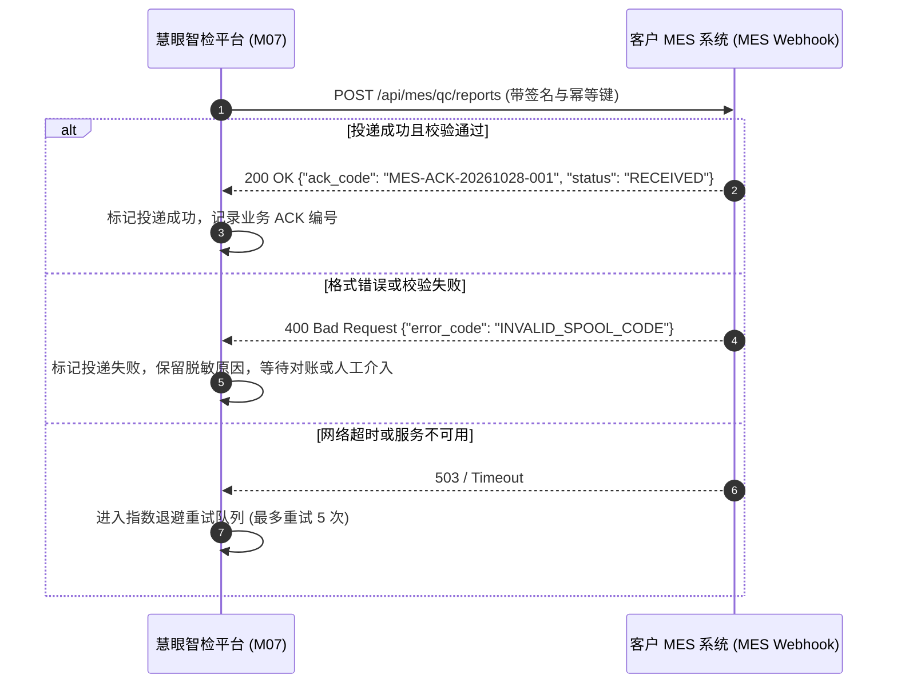

# 客户 MES 质量检验出站报文契约

> **契约版本**：v1.0  
> **编制依据**：参考原件《慧眼智检-宏亮电缆有限公司应用方案.docx》、第 05 份接口总契约文档及后续开发计划清单 WP2.3  
> **协议格式**：HTTP/1.1 POST JSON / HTTPS  
> **适用模块**：`apps/platform/modules/m07-mes/`（MES 出站投递与对账模块）

---

## 一、 接口概述与调用时序

当高压电缆一盘检测任务结束（`TaskEnded`）或生成整盘阶段汇总报告时，慧眼智检平台通过内部发件箱机制（Outbox Pattern）异步且可靠地向客户 MES 系统推送《质检完工数据包》。



---

## 二、 出站投递接口定义

- **请求方法**：`POST`
- **请求路径**：由客户 MES 配置决定（默认测试桩：`/api/mes/qc/reports`）
- **请求头**：
  - `Content-Type`: `application/json`
  - `Authorization`: `Bearer <MES_API_TOKEN>`（凭据在 M07 中配置并脱敏存储）
  - `X-Idempotency-Key`: `<UNIQUE_DELIVERY_UUID>`（幂等去重键，重试保持不变）
  - `X-Signature`: `<HMAC_SHA256_HEX>`（报文体防篡改摘要）

---

## 三、 请求报文体字段定义（JSON）

```json
{
  "delivery_id": "9b1deb4d-3b7d-4bad-9bdd-2b0d7b3dcb6d",
  "send_time": "2026-10-28T10:40:00.000Z",
  "factory_code": "FACTORY-01",
  "work_order_code": "WO-20261028-001",
  "spool_code": "SPOOL-20261028-01",
  "specification_code": "SP035-400",
  "product_name": "35kV 1x400mm² 交联聚乙烯绝缘高压电力电缆",
  "inspection_scope": {
    "total_length_m": 1000.0,
    "effective_coverage_m": 998.5,
    "start_time": "2026-10-28T09:00:00Z",
    "end_time": "2026-10-28T10:30:00Z"
  },
  "overall_verdict": "PASS",
  "metric_results": [
    {
      "metric_code": "SHIELD_OVERLAP_RATE",
      "metric_name": "金属屏蔽铜带搭盖率",
      "unit": "%",
      "sample_count": 2000,
      "failed_count": 0,
      "rule_expression": ">= 10.0%",
      "mean_value": 14.85,
      "min_value": 11.20,
      "max_value": 18.50,
      "verdict": "PASS"
    },
    {
      "metric_code": "WIRE_GAP",
      "metric_name": "铜丝屏蔽相邻间隙",
      "unit": "mm",
      "sample_count": 2000,
      "failed_count": 0,
      "rule_expression": "<= 3.0mm",
      "mean_value": 1.15,
      "min_value": 0.80,
      "max_value": 2.45,
      "verdict": "PASS"
    },
    {
      "metric_code": "OVALITY",
      "metric_name": "电缆不圆度",
      "unit": "%",
      "sample_count": 2000,
      "failed_count": 0,
      "rule_expression": "<= 8.0%",
      "mean_value": 1.25,
      "min_value": 0.35,
      "max_value": 3.10,
      "verdict": "PASS"
    }
  ],
  "inspector": {
    "operator_name": "张工",
    "operator_id": "user-001"
  }
}
```

---

## 四、 MES 系统预期应答规范

MES 接收成功后返回 HTTP 200：
```json
{
  "code": 0,
  "message": "SUCCESS",
  "data": {
    "ack_code": "MES-ACK-20261028-001",
    "received_at": "2026-10-28T10:40:01.120Z",
    "status": "ACCEPTED"
  }
}
```

若 MES 返回非 2xx（如 500、503 或网络中断），平台 M07 模块将保留本次投递记录并启动指数退避重试（10s, 30s, 1m, 5m, 15m），并在管理控制台提供人工“一键对账补发”能力。
