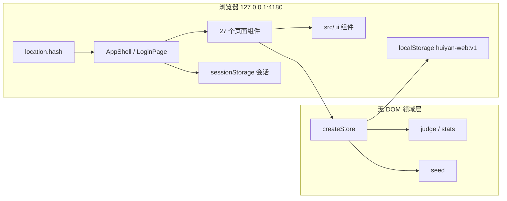
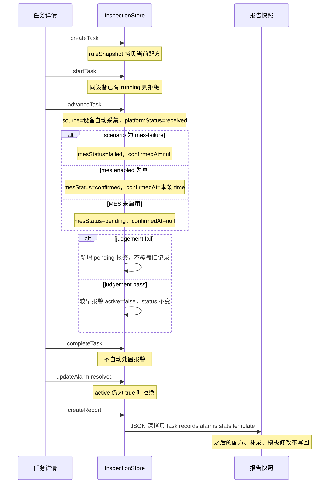
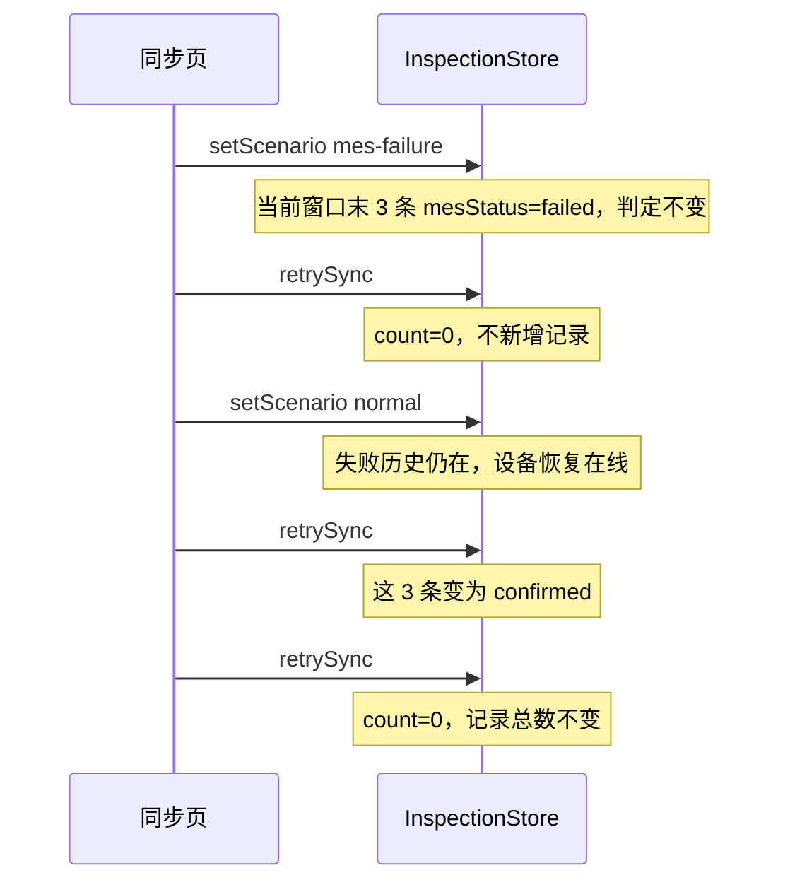

# 慧眼智检 · 线缆质量管控平台前端实现设计

| 项 | 内容 |
| --- | --- |
| 文档标题 | 慧眼智检 · 线缆质量管控平台前端实现设计 |
| 作者 | 前端设计 |
| 日期 | 2026-10-13 |
| 状态 | Draft |
| 产品 | 慧眼智检 · 线缆质量管控平台 |
| 适用范围 | 35–220 kV 高压电缆；仅金属屏蔽搭盖率、铜丝屏蔽相邻铜丝间隙、电缆不圆度 |
| 原型 oracle | `E:\Chenjiyan\Projects\huiyanzhijian\慧眼智检-原生原型` |
| 新应用目录 | `E:\Chenjiyan\Projects\huiyanzhijian\web` |
| 约束 | 本设计不修改原型目录中的任何文件。原型继续作为视觉、文案和领域规则的对照物。 |

## Overview

原生原型是一套无构建的单页应用：`index.html` 顺序加载 `js/data.js`、`js/ui.js`、`js/pages-core.js`、`js/pages-management.js`、`js/app.js`，全部挂在 `window.HY` 上，用 URL hash 画出 27 个页面。领域规则、演示数据和本地持久化已经可用，并通过 `tests/domain.test.js`、`tests/core.test.js`、`tests/navigation.test.js`、`tests/integration.test.js` 共 48 项检查。它不适合继续作为可维护的前端：页面用字符串拼接 HTML，权限散落在 action 包装器里，图表和焦点逻辑与整页 `innerHTML` 重绘绑在一起。

本设计把同一产品重做成独立的 Vite + React + TypeScript 应用，放在仓库内新建的 `web/` 目录。领域规则从 `js/data.js` 的 `HY.Store` 原样移植为不依赖 DOM 的 TypeScript 模块；界面按 `HY.UI` 和现有 CSS class 重建，而不是换一套组件库皮肤。第一期仍然没有后端：业务状态写入 `localStorage`，登录会话写入 `sessionStorage`，hash 路由与原型保持一致。后期若接入 API，替换的是持久化适配器和会话，不改判定、快照和幂等语义。

## Background & Motivation

仓库根目录 `E:\Chenjiyan\Projects\huiyanzhijian\README.md` 只有标题。产品说明在 `慧眼智检-原生原型\README.md`，实现契约在 `慧眼智检-原生原型\IMPLEMENTATION.md`，视觉验收在 `慧眼智检-原生原型\design-qa.md`。静态服务是 `server.cjs`，只监听 `127.0.0.1:4174`，不提供接口。

当前实现的痛点是结构，不是缺页面：

- `js/pages-core.js` 约 49 KB，`js/pages-management.js` 约 64 KB，每个页面返回一整段 HTML。改一个筛选字段要同时改字符串、`HY.filters` 和 action 名。
- `HY.UI.esc` 是唯一的 XSS 边界。集成测试明确要求用户输入的 `` 必须变成 `&lt;img`。字符串模板里漏一次 `E()` 就会破掉。
- `H.render()` 每次清空 `#app` 并重建图表。回放游标、导入预览、侧栏展开和焦点要靠模块级变量扛过整页重绘，见 `app.js` 的 `opened`、`playback`、`importPreview`。
- 权限有三套出口：`pages-core.js` 末尾对 8 个 `core-*` action 抛错；`pages-management.js` 的 `permit(adminOnly)` 直接 toast；`app.js` 的 `record-retry` 又是第三句提示。没有类型能防止新按钮绕过它们。
- 领域函数已经能在 Node 里测，但页面测试靠 `vm` 执行浏览器脚本并断言 HTML 子串。换组件模型后不能继续把 `data.js` 当运行时。

相邻项目 `E:\Chenjiyan\Projects\anquanxiaofang`（`package.json` 的 `name` 为 `guokong-safety-inspection-demo`）使用 Vite 6、React 18、TypeScript，并用 `localStorage` / `sessionStorage` 做演示持久化。本设计只复用这类工程做法。不复用其消防、隐患、任务或任何 API、路由和文案。

原型已经钉死、新前端不得改写的业务事实：

- 判定：搭盖率 `>= 10%`，平均铜丝间隙 `<= 3 mm`，不圆度 `<= 8%`。边界值算符合。比较方向不可反转。
- 无效值是 `null`，不是 `0`。`0` 对间隙是合法且符合阈值。无效记录不进入 `stats` 的 valid / pass / fail / min / max / avg，但可以成为 `stats.last`。
- 配方 `reviseRecipe` 生成新版本并停用同指标旧版本，只影响之后 `createTask`。任务和记录上的 `ruleSnapshot` 不改写。
- `createReport` 写入 `snapshot` 的深拷贝。之后改模板、规格、设备、补录或推进任务，都不得改变已有报告。
- 一台设备同时只能有一个 `running` 任务。`startTask` 拒绝第二台。
- 报警 `active` 可随恢复变为 `false`，`status` 不因此变成 `resolved`。`active === true` 时不能把状态改成 `resolved`。处置必须有说明。
- `setScenario('mes-failure')` 把当前窗口末 3 条标为 `failed`，不改 `validity` 和 `judgement`。`retrySync` 对已 `confirmed` 的记录不再发送；失败场景下重试仍失败；切回 `normal` 后重试确认，且不新增记录。
- CSV / 补录按行返回错误。重复键是 `taskId + time + meter`。单次最多 10,000 行。
- 演示业务时钟是 `settings.demoTime`，初值 `2026-10-09 14:30:00`。审计时间是真实 `new Date().toISOString()`。两者不可混用。
- 量测图是演示素材。不圆度的 X / Y 外径是辅助数据，不推导全周公式。`aux.formula` 必须保持不存在。

## Goals & Non-Goals

### Goals

- 在 `web/` 交付可维护的前端，覆盖原型全部 27 个 hash 页面及详情参数。
- 把 `HY.Store` 的实体、字段和变更函数移植为可单测的领域模块，中文错误文案保持稳定，使现有领域断言能逐条迁过来。
- 用 React 组件承接 `HY.UI`，继续使用原型的 CSS class 和设计令牌，使 1920×1080、1440×900、1366×768 和 390×844 可以对照 `qa/` 截图验收。
- 权限矩阵以 `app.js`、`pages-core.js`、`pages-management.js` 的实际判断为准，不另发明角色。
- 第一期持久化仍在浏览器本地，并在存储失败时降级为内存演示。
- 给出可独立评审、可独立合并的 PR 顺序。PR 1 只建立可运行的空壳。

### Non-Goals

- 生产后端、真实账号体系、真实设备协议、真实 MES、真实 YOLO 或视觉模型。
- 就地改写 `慧眼智检-原生原型`，或把原型发布到 GitHub Pages。
- 增加搭盖率、铜丝间隙、不圆度以外的检测项目，或 35 / 66 / 110 / 220 kV 以外的电压等级。
- 把演示图当成现场帧，或由 X / Y 外径反推不圆度。
- 引入 Ant Design、Tailwind、CSS-in-JS 或在线字体 / CDN。
- 复制 `anquanxiaofang` 的业务页面、store key 或服务端路由。
- 从原型 JSON 或 `huiyan-native-prototype:v1` 导入数据。两套存储键保持分开。
- 服务端 PDF。报告导出只用浏览器打印。

## Proposed Design

### 放置位置

新应用根目录：

`E:\Chenjiyan\Projects\huiyanzhijian\web`

原型目录保持不动，包括 `qa/`、`assets/`、`tests/` 和 `server.cjs`。两边可以同时开：原型 `node server.cjs` 在 `127.0.0.1:4174`，新应用 Vite 固定 `127.0.0.1:4180`（`strictPort: true`）。4180 被占用时只改 Vite 配置，不改回 `4174`。端口分开后，`localStorage` 天然按源隔离；即便如此，新应用仍使用独立的存储键，避免以后被放到同一源时互相覆盖。不做从原型 JSON 或 localStorage 的导入。

| 键 | 原型 | 新应用 |
| --- | --- | --- |
| 业务状态 | `huiyan-native-prototype:v1` | `huiyan-web:v1` |
| 会话 | `hy-session-v1` | `hy-web-session-v1` |
| 记住账号 | `hy-remember-account` | `hy-web-remember-account` |

不自动读取原型键。需要对照时，由人在两个源上分别操作。`localhost` 与 `127.0.0.1` 在原型里已经是不同源，新应用文档和登录页脚保留这一说明，开发服务器只绑定 `127.0.0.1`。

### 技术栈决定

选用 Vite 6 + React 18 + TypeScript 5，开发依赖为 `@vitejs/plugin-react`、`tsx`、Vitest。图表依赖 `echarts@6.0.0`，与原型 `assets/vendor/echarts.min.js` 的主版本对齐，打包进产物，运行时不访问 CDN。

不引入 React Router。原型路由是 `location.hash` 加 `URLSearchParams`，详情页、检测页和规格页都把查询串当作状态。自写约一个模块的 hash 解析器，可以把 `#detection?metric=dg&task=T20261009001` 原样保留，也避免路由库的嵌套约定。

状态不使用 Redux 或 Zustand。领域 store 是纯模块，React 用 `useSyncExternalStore` 订阅 `getState` 返回的同一根引用，筛选放在 `useMemo`。这和原型的 `HY.Store` 单仓库一致，也便于 Node 测试不启动浏览器。不要写一个每次 `filter` 都返回新数组的选择器。

相邻项目证明本机已经能构建这条工具链（`anquanxiaofang/package.json` 的 `vite`、`react`、`typescript`，以及 `src/features/resources/ResourceContext.tsx` 一类的本地 JSON 持久化）。依赖列表到此为止，不安装该项目的 Express、OpenAI、Recharts、Lucide 或 WebSocket。

### 总体架构



依赖方向固定为：`pages` 和 `ui` 可以调用 `domain`；`domain` 不得 import React、`document` 或 `localStorage`。持久化通过构造函数注入。

```ts
export interface Persistence {
  read(key: string): string | null;
  write(key: string, value: string): void;
}

export interface StoreOptions {
  persistence: Persistence;
  now?: () => string; // 审计时钟，默认 () => new Date().toISOString()
}

export function createStore(options: StoreOptions): InspectionStore;
```

浏览器传入 localStorage 适配器：`write` 抛出或配额失败时把 `memoryOnly` 设为 `true`，状态留在内存，设置页显示「内存模式」。测试传入 `Map`。这样 `tests/domain.test.js` 里 `blocked: true` 的用例可以原样表达。

### 目录

```text
web/
  index.html
  package.json
  vite.config.ts
  tsconfig.json
  public/assets/images/          从原型复制的 13 张 PNG，路径保持 assets/images/*
  public/assets/icons/           只用到的 Tabler SVG，不是 4964 张全量
  public/assets/vendor/          ECharts 与 Tabler 的 LICENSE / NOTICE 副本
  src/main.tsx
  src/app/App.tsx
  src/app/hashRoute.ts
  src/app/nav.ts                 app.js 的 titles 与 groups
  src/app/useAppState.ts         订阅 getState 根引用，不在快照里筛选
  src/app/shell/AppShell.tsx
  src/app/shell/LoginPage.tsx
  src/auth/session.ts
  src/auth/permissions.ts
  src/domain/types.ts
  src/domain/metrics.ts
  src/domain/judge.ts
  src/domain/stats.ts
  src/domain/seed.ts
  src/domain/store.ts
  src/domain/csv.ts
  src/domain/store.test.ts
  src/persistence/localStoragePersistence.ts
  src/persistence/memoryPersistence.ts
  src/ui/                        对应 HY.UI；记录抽屉在 src/ui/RecordDrawer.tsx
  src/charts/trendOption.ts      对应 U.mountCharts 的 setOption
  src/pages/                     一页一个目录，见路由表
  src/styles/tokens.css          从 styles.css :root 抽出
  src/styles/styles.css          移植原型 css/styles.css
  src/styles/core.css            移植原型 css/core.css
```

页面 class 不重命名。原型用 `page page-dashboard`、`core-panel`、`grid cols-5`、`split` 写了按页的高度修正，见 `css/core.css` 末尾的 `.page-dashboard`、`.page-detection`、`.page-monitor`、`.page-history`、`.page-settings`。换 class 会使 `design-qa.md` 的截图对照失效。

### App Shell

登录与登录后是两套树，对应 `app.js` 的 `H.render`：

- 无会话且 hash 不是 `#login`：记住完整 hash（不含 `#`）为 `returnRoute`，改到 `#login`。
- 有会话且 hash 是 `#login`：改到 `#dashboard`。
- 有会话：渲染 `AppShell`，主体为 `Pages[route]`。未知 route 显示「页面不存在」和回工作台的链接，不抛白屏。页面函数抛错时显示「页面加载失败」和重新加载，对应 `app.js` 的 `try/catch`。

`AppShell` 结构与 `shell()` 一致：

- 遮罩按钮 `.mobile-backdrop`，`data-action` 语义改为关闭导航。
- `<aside id="primary-navigation" aria-label="主导航">`，宽 248px，底色 `#f9fbfe`，右边框 `#dfe7f1`。Logo `assets/images/logo.png`，alt 为「慧眼智检 AI线缆智能检测装备」。平台名来自 `settings.platformName`，缺省「线缆质量管控平台」。
- 导航顺序固定：工作台、综合监控、检测中心分组、检测任务、产品规格档案、历史与数据追溯分组、报警事件、分析与质量报告分组、质量配置分组、设备与接口分组、系统管理分组。分组定义直接来自 `app.js` 的 `groups`。
- 侧栏底部文案：`慧眼智检 · 质见未来`、`35–220kV 高压电缆`、`聚焦三项关键量测指标`、机构名 `settings.organization || settings.company || 山东沉积岩信息科技有限公司`。
- 顶栏高 67px。面包屑为「慧眼智检 / {标题}」。非检测页用 `app.js` 的 `titles`，不要用侧栏短名，也不要用页面里另一套 `h1` 去填面包屑。检测页例外：`S.metrics[params.get('metric') || 'dg']?.name + '检测'`。这里**不**做未知 metric 到 `dg` 的回退；`#detection?metric=foo` 的面包屑是字符串 `undefined检测`，而页面 `h1` 仍是「金属屏蔽搭盖率检测」。`document.title` 另走 `titles[route] || '慧眼智检'` 再加 ` · 慧眼智检`，检测页因此是「检测中心 · 慧眼智检」，不跟面包屑的指标名走。对照表见路由表。
- 顶栏工具：链接 `#settings` 的「演示数据 · 非现场实测」、`settings.demoTime`、未处置报警计数（`status !== 'resolved'`）、当前用户按钮。
- `<main id="main-content" class="page page-{route}" tabindex="-1">`。

活动项规则，必须与 `nav()` / `group()` 一致：

- `#tasks` 在 `#task` 时也高亮。
- `#alarms` 在 `#alarm` 时也高亮。
- 报告分组在 `#report` 时也视为当前分组。
- 检测子项比较完整串 `detection?metric=dg|jx|by`，缺省 metric 为 `dg`。
- 路由名变化时，展开集合重置为 `{detection}` 再加当前分组。同一路由内用户手风琴状态保留。侧栏 `.nav-scroll` 独立滚动。

窄屏行为移植 `navigation.test.js` 的 9 条，而不是只做 CSS：

- 断点 `matchMedia('(max-width: 1023px)')`。
- 关闭时侧栏 `inert` 且 `aria-hidden=true`，菜单按钮 `aria-expanded=false`，`aria-controls="primary-navigation"`。
- 打开时内容区 `.app-shell` `inert`，焦点落到当前 `.nav-item.active` 或 `.subnav a.active`。
- Tab 在侧栏内循环。Escape 关闭并焦点回到菜单按钮。
- 模态或抽屉打开时，Tab 和 Escape 先作用于对话框，不关闭导航。
- hash 变化关闭导航并把焦点送到 `#main-content`。
- 从窄屏拉回桌面时取消 `inert`，焦点回到当前导航项；再变窄且焦点在侧栏内时，焦点回到菜单按钮。

登录页移植 `login()`，不改文案：

- 顶栏：Logo，以及「35–220kV 高压电缆　 |　 三项关键指标量测」。
- 品牌区：眉题「电缆关键指标AI量测与质量数据解决方案」，主标题「慧眼智检」，副标题「线缆质量管控平台」，「检测有据 · 质量可溯 · 数据可联」，`device-family.png`，三项指标卡（搭盖率 ≥ 10%、铜丝间隙 ≤ 3mm、不圆度 ≤ 8%）和 `metric-dg.png` / `metric-jx.png` / `metric-by.png`。
- 表单：账号、密码 `minLength={4}`、记住账号、联系管理员、登录。密码只做长度检查，不与任何存储口令比对，也不写入状态。
- 身份快捷按钮保持原型的不对称映射。2026-10-13 已决定不把「质量管理员」改成「系统管理员」。三个按钮都写入密码 `demo1234`（`demo-role` 对每个 `data-role` 都赋这个值，不只是管理员），账号映射保持 `admin` / `operator` / `viewer`：
  - 「质量管理员」填入账号 `admin`、密码 `demo1234`。该用户 `role` 是 `admin`，显示名是「质量管理员」。
  - 「检测操作员」填入账号 `operator`、密码 `demo1234`。`role` 是 `quality`。
  - 「只读访客」填入账号 `viewer`、密码 `demo1234`。`role` 是 `viewer`。账户抽屉用通用 `labels`，徽章文案是「只读查看者」，不是按钮上的「只读访客」，也不是用户页的「只读观察员」。
- 账号 `quality`（显示名「质量审核员」，`role` 仍是 `quality`）不在快捷按钮上，但手工输入可以登录。停用用户提示「账号不存在或已停用，请选择演示身份。」
- 联系管理员模态说明机构「山东沉积岩信息科技有限公司」，并列出 `admin` / `operator` / `viewer`。
- 登录成功写入会话 `{id, name, username, role}`，记一条审计「登录系统」，再回到 `returnRoute` 或 `#dashboard`。退出先记「退出登录」，清会话，回到 `#login`。

### 路由表

27 个逻辑页与 `tests/integration.test.js` 的 `pages` 数组一致。侧栏、面包屑和 `h1` 是三套字符串，不能互相填。面包屑来自 `app.js` 的 `titles`（检测页另算）。`h1` 来自各页 `title(...)` 的第一个参数。侧栏来自 `nav()` / `groups`。

| 序 | Hash | 侧栏 | 面包屑 | h1 | 原型函数 | 缺省与参数 |
| --- | --- | --- | --- | --- | --- | --- |
| 01 | `#login` | 无壳 | 无 | 品牌「慧眼智检」；表单「欢迎登录」 | `app.js` `login` | 不包 Shell |
| 02 | `#dashboard` | 工作台 | 工作台首页 | 工作台首页 | `P.dashboard` | 无 |
| 03 | `#monitor` | 综合监控 | 产线与设备实时总览 | 产线与设备实时总览 | `P.monitor` | 筛选键 `monitor` |
| 04 | `#detection?metric=dg` | 金属屏蔽搭盖率检测 | 金属屏蔽搭盖率检测 | 金属屏蔽搭盖率检测 | `P.detection` | 可加 `task` |
| 05 | `#detection?metric=jx` | 铜丝屏蔽相邻铜丝间隙检测 | 铜丝屏蔽相邻铜丝间隙检测 | 铜丝屏蔽相邻铜丝间隙检测 | 同上 | 同上 |
| 06 | `#detection?metric=by` | 电缆不圆度检测 | 电缆不圆度检测 | 电缆不圆度检测 | 同上 | 同上 |
| 07 | `#tasks` | 检测任务 | 检测任务列表 | 检测任务列表 | `P.tasks` | 筛选键 `tasks` |
| 08 | `#task?id=T20261009001` | 高亮「检测任务」 | 检测任务详情 | 检测任务详情；找不到时副标题「该任务不存在，或已从本地演示数据移除。」，空态「任务不存在」 | `P.task` | 见下表 |
| 09 | `#specs` | 产品规格档案 | 高压电缆产品规格档案 | 高压电缆产品规格档案 | `P.specs` | 见下表 |
| 10 | `#history` | 历史检测数据 | 历史检测数据查询 | 历史检测数据查询 | `P.history` | 首次进入且还没有 `filters.history` 时，筛选项只存到分钟：起点是把 `demoTime` 当成 UTC 减 29 分钟后的 `toISOString().slice(0, 16)`，终点是 `demoTime.replace(' ','T').slice(0, 16)`。种子为 `2026-10-09T14:01` 与 `2026-10-09T14:30`。比较时 start 只把 `T` 换成空格，end 为 `f.end.replace('T',' ') + ':59'`，这样才包含 `14:30:00`，默认 90 条而不是 87 条。不要用裸的 `demoTime` 或分钟串直接 `<=`。`?metric=` 仅在筛选尚未写过 metric 时生效；`?record=` 打开记录抽屉 |
| 11 | `#trace?reel=P20261009001` | 盘号追溯详情 | 盘号追溯详情 | 盘号追溯详情 | `P.trace` | 见下表 |
| 12 | `#import` | 数据导入与补录 | 数据导入与补录 | 数据导入与补录 | `P.import` | 预览只活在内存 |
| 13 | `#alarms` | 报警事件 | 报警事件 | 报警事件 | `Pages.alarms` | 筛选键 `alarms`。没有「报警事件列表」这个标题 |
| 14 | `#alarm?id=AL20261009001` | 高亮「报警事件」 | 报警详情与处置 | 报警详情与处置；失败时 `h1` 改为 `missing()` 的文本 | `Pages.alarm` | 见下表 |
| 15 | `#analytics` | 质量统计分析 | 质量统计分析 | 质量统计分析 | `Pages.analytics` | 筛选键 `analytics` |
| 16 | `#reports` | 质量报告管理 | 质量报告管理 | 质量报告管理 | `Pages.reports` | 筛选键 `reports` |
| 17 | `#report?id=RP20261009001` | 高亮报告分组 | 报告预览与导出 | 报告预览与导出；无报告时 `h1` 为「尚无质量报告」 | `Pages.report` | 见下表 |
| 18 | `#metrics` | 三项检测指标配置 | 三项检测指标配置 | 三项检测指标配置 | `Pages.metrics` | 无 |
| 19 | `#recipes` | 配方与判定规则 | 配方与判定规则 | 配方与判定规则 | `Pages.recipes` | `?metric=` 作为筛选初值 |
| 20 | `#templates` | 报告模板配置 | 报告模板配置 | 报告模板配置 | `Pages.templates` | 无 |
| 21 | `#devices` | 设备档案 | 设备档案 | 设备档案 | `Pages.devices` | 筛选键 `devices` |
| 22 | `#connections` | 数据接入配置 | 数据接入配置 | 数据接入配置 | `Pages.connections` | 无 |
| 23 | `#mes` | MES接口配置 | MES接口配置 | MES 接口配置 | `Pages.mes` | 面包屑无空格，`h1` 在 MES 与「接口」之间有空格 |
| 24 | `#sync` | 同步监控 | 同步监控 | MES 同步监控 | `Pages.sync` | 筛选键 `sync`。代码里没有「数据同步监控」 |
| 25 | `#users` | 用户角色与权限 | 用户角色与权限 | 用户角色与权限 | `Pages.users` | 筛选键 `users` |
| 26 | `#audit` | 操作审计 | 操作审计 | 操作审计 | `Pages.audit` | 筛选键 `audit` |
| 27 | `#settings` | 系统设置与运行状态 | 系统设置与运行状态 | 系统设置与运行状态 | `Pages.settings` | 无 |

详情参数按原型的判断函数分叉，不要合成一句「不存在则空态」：

| 页面 | 无参数 | 参数在但查不到 | 空字符串 |
| --- | --- | --- | --- |
| `#task` | `get('id')` 为空，用 `tasks[0]`（种子 `T20261009001`）。不用 `has('id')` | `h1` 仍是「检测任务详情」，空态「任务不存在」。不改去显示别的任务 | `?id=` 的值是 `''`，在原型里为假，走 `tasks[0]`，与无参数相同 |
| `#alarm` | `has('id')` 为假，用 `alarms[0]`（种子 `AL20261009001`） | `missing('暂无报警事件')`：`h1` 变成「暂无报警事件」。记录缺失则 `h1` 为「关联量测记录不存在」。不展示另一条报警 | `?id=` 时 `has('id')` 为真，查找失败，走「暂无报警事件」 |
| `#report` | `has('id')` 为假，用 `reports` 最后一项。种子是 `RP20261009009`，不是第一项，也不是空态 | `missing('尚无质量报告')`。`h1` 为「尚无质量报告」，副标题「请从列表中选择对应记录。」。不得改去渲染数组里的另一份报告 | `?id=` 同样算 `has('id')`，查找失败，走「尚无质量报告」 |
| `#specs` | `S.spec(get('id'))` 失败后用**当前筛选结果**的第一行，不是全表第一行 | 与无参数相同，落回当前筛选第一行。筛选被滤空时详情区才是空态 | 与无参数相同 |
| `#trace` | `get('reel')` 为空时用 `tasks[0].reelId`（种子 `P20261009001`） | 不换盘号，页面仍用这个不存在的盘号，任务表为空。没有 `missing()` | `?reel=` 为假，走第一条任务的盘号 |

筛选对象和页码是会话 UI 状态，对应 `HY.filters` 与 `HY.pagination`，不写入 `huiyan-web:v1`。刷新即丢失，与原型一致。提交筛选把该键的页码置为 1。

检测页选任务的规则来自 `detectionContext()` / `detectionRows()`，工作台和监控也依赖它，必须抽成 `src/domain/detectionWindow.ts` 并先被测试锁住：

```ts
export function detectionRows(records: Record[], task: Task | null): Record[] {
  if (!task) return [];
  const rows = records.filter(r => r.taskId === task.id)
    .slice()
    .sort((a, b) => a.time.localeCompare(b.time));
  if (!rows.length) return [];
  const end = rows[rows.length - 1].time;
  const start = timeAdd(end, -29 * 60);
  return rows.filter(r => r.time >= start && r.time <= end);
}

const metricOf = (key: string | null): Metric => metrics[key || 'dg'] || metrics.dg;

export function detectionContext(state: AppState, params: URLSearchParams): DetectionContext {
  const requested = params.get('task');
  const fallbackMetric = metricOf(params.get('metric'));
  const sameMetric = state.tasks.filter(t => t.metric === fallbackMetric.id);
  const task = requested
    ? state.tasks.find(t => t.id === requested) ?? null
    : sameMetric.find(t => t.status === 'running')
      ?? sameMetric.slice().sort((a, b) =>
        String(b.startAt || b.createdAt || '').localeCompare(String(a.startAt || a.createdAt || ''))
      )[0]
      ?? null;
  return {
    task,
    metric: task ? metricOf(task.metric) : fallbackMetric,
    records: detectionRows(state.records, task),
    missing: !!requested && !task,
  };
}
```

`metric` 的返回值是指标对象，形状与 `HY.Store.metrics` 的条目相同（`id`、`name`、`short`、`unit`、`threshold`、`operator`、`color`、`icon`、`image`），不是字符串 id。未知键先归一成 `dg` 再找任务：`#detection?metric=foo` 按搭盖率的运行任务取数，页面 `h1` 是「金属屏蔽搭盖率检测」。不要另写 `latestTaskOfMetric`。比较键是 `startAt || createdAt` 的字符串降序，不是任务 id，也不是单独的 `createdAt`。没有 `task` 参数（含空字符串，因为 `get('task')` 为空时为假）时，先取该指标 `status === 'running'` 的任务，否则取上面这条排序的第一条。

面包屑不走 `metricOf`。`#detection?metric=foo` 的面包屑仍是字符串 `undefined检测`，和这里的 `h1` 故意不一致。

因此：`#detection?metric=dg` 初始只含 `T20261009001` 的 30 条；新建并开始一个尚无样本的搭盖率任务后，工作台搭盖率图是 0 条，不得再把 `12.36%` 标成当前值；显式 `task=T20261009001` 仍看原任务。这三句分别对应 `tests/core.test.js` 的前三个及第六个用例。

`currentRecords(metric?)` 是另一窗口：以 `settings.demoTime` 的完整秒为终点，向前 29 分钟，含全部指标。比较用带秒的演示时间，初始为 90 条。历史页不是把这个窗口原样套上去。`historyRows()` 在 `filters.history` 还不存在时，把 `datetime-local` 只存到分钟：起点是 `new Date((demoTime || '2026-10-09 14:30:00').replace(' ','T') + 'Z')` 再减 `29 * 60000` 后的 `toISOString().slice(0, 16)`，终点是 `demoTime.replace(' ','T').slice(0, 16)`。种子因此是 `2026-10-09T14:01` 和 `2026-10-09T14:30`。过滤时 `start = f.start ? f.start.replace('T',' ') : ''`，不补秒；`end = f.end ? f.end.replace('T',' ') + ':59' : ''`。空串表示该侧不限制。`2026-10-09 14:01:00` >= `2026-10-09 14:01` 仍为真；`2026-10-09 14:30:00` <= `2026-10-09 14:30` 为假，所以必须变成 `2026-10-09 14:30:59` 才留得住三条运行任务的末条。默认结果是 90 条，不是 87 条，也不是全表 198 条。`tests/core.test.js` 断言历史页含「共 90 条记录」。不要用裸的 `demoTime` 或分钟串直接做 `<=`。

### 页面行为摘要

每页只实现原型已有区块。下列是实现时不能漏的行为，不是视觉再设计。

**工作台 `P.dashboard`。** `h1` 与面包屑都是「工作台首页」，侧栏才是「工作台」。五张 KPI 的第一张标签是「今日检测任务」，值是 `tasks.length`（种子为 12），不按 `demoDate` 过滤；副标题是「检测中 n · 已完成 m」。其余四张：在线设备 `n / 总数`、当前运行任务上的超限事件数、未处置报警数、当前窗口 MES 确认比例。三张指标卡走 `detectionRows(runningTask)`，没有运行任务时才退回 `currentRecords`。下方是运行中任务表（最多 4 条，链接带 `detection?metric&task`）和待办。待办最多两条未处置报警。页底说明：当前值符合阈值不代表整盘合格。任务列表上的另一张 KPI 叫「今日任务总数」，值同样是 `tasks.length`，不要和这一张的标签混用。

**监控 `P.monitor`。** `h1` 与面包屑是「产线与设备实时总览」，侧栏是「综合监控」。按产线、设备类型、在线状态筛选。每台设备一张卡，图为 `assets/images/device-{metric}.png`。主数值是该设备运行任务的 `detectionRows` 最后一条的 `metricFmt`，没有记录时是「—」，旁边徽章是「暂无数据」。不得把上一任务的 `12.36` 填进主数值，也不得把主数值写成「空闲」。`core.test.js` 锁的是不得出现 `<strong>12.36`。「空闲」只出现在「任务状态」格：没有运行任务时 `U.badge('空闲','gray')`，有任务时走 `taskStatus`。最近 6 条来自当前窗口且属于筛选后设备。页底说明三款设备图不表示它们装在同一条产线。

**检测 `P.detection`。** 指定任务不存在时整页空态。未知 `metric` 不走空态：先归一成 `dg` 再找任务，`h1` 仍是「金属屏蔽搭盖率检测」。KPI 五张：当前值、窗口最小、最大、平均、任务规则阈值。无效或没有记录时当前值显示等待，不显示 0。趋势工具：时间轴 / 米数轴、回放、回到当前。回放间隔是 `settings.refreshInterval` 秒，默认 5，可选 2 / 5 / 10 / 30；游标只切片已有记录，不调用 `advanceTask`。离开检测页或任务 id 变化必须 `clearInterval`。明细只显示当前切片最新 4 条。报警列表只含本任务。不圆度副标题写明外径是辅助数据。

**任务列表 `P.tasks`。** 筛选工单/盘号/任务号、指标、状态、开始日期。KPI 四张。表列含电压、规格、设备、执行状态和 MES 汇总。MES 汇总规则在 `taskSync()`：无记录「待采集」；任一 `failed`「同步失败」；任一非 `confirmed`「同步中」；否则运行中仍「同步中」、已完成「已确认」。说明文案：一个任务只含该规格适用的项目。

**任务详情 `P.task`。** 待开始显示「开始检测」；检测中显示「采集下一条」和「结束检测」。报告按钮：已完成且仍有未处置报警时，链接到那条报警（「先复核异常」），否则「生成最终报告」或运行中的「预览阶段报告」。进度按 `measuredLength / plannedLength`。执行日志按时间合并创建、分配、开始、超限、报警历史、相关审计、最近 MES 确认和结束，去重后不得渲染成 `DG-V1.0 · V1.0` 这种版本号双写。`core.test.js` 要求 `T20261009001` 日志顺序含 `12:50:00`、`12:55:00`、`13:00:00`、`14:06:00`、`14:07:00`、`14:30:00`。种子任务没有 `createdAt` 之前 5 分钟的独立字段；原型用 `^T20261009\d{3}$` 且存在 `startAt` 时，把分配时间显示为开始前 5 分钟。移植这个演示特例，不要推广到用户新建任务。新建任务的分配时间就是 `createdAt`。

**规格 `P.specs`。** 左表右详情。屏蔽结构 `tape` 为铜带，适用 `dg` 与 `by`；`wire` 为铜丝，适用 `jx` 与 `by`。编辑校验：铜带不得包含 `jx`，铜丝不得包含 `dg`，至少一项。电压只允许 35 / 66 / 110 / 220。新建 id 重复则拒绝。此操作是 `canWrite`，不是管理员专属。2026-10-13 已决定保持这样：`quality` 可以编辑规格；设备、接入、MES、用户仍只有 `admin`。不要把规格收紧成管理员专属。

**历史 `P.history`。** 时间筛选分两步，与 `historyRows()` 一致。表单用 `datetime-local`，值只到分钟；种子首次进入写入 `2026-10-09T14:01` 和 `2026-10-09T14:30`，不是带秒的 `demoTime`。比较时 start 只做 `replace('T',' ')`，end 做 `replace('T',' ') + ':59'`，再 `r.time >= start` 且 `r.time <= end`。结束边界因此是 `2026-10-09 14:30:59`，三条 `14:30:00` 的记录留在表内，默认「共 90 条记录」。若 end 停在 `2026-10-09 14:30`，字符串比较会丢掉这 3 条，变成 87 条。KPI 使用 `stats(筛选结果)`。三张小图高度约 150，且 `metricCard` 把记录再反转回时间正序后作图。导出调用全量筛选结果，不是当前页。空结果 toast「当前查询无可导出的记录」，且不得用上一次的文件代替。CSV 有 UTF-8 BOM。搭盖率加超限加盘号 `P20261009001` 时是 1 行，值 `9.2`，规则版本 `DG-V1.0`。

**追溯 `P.trace`。** 盘号下拉来自全部任务。三张图：有记录才画图；任务包含该指标但还没记录时「等待量测数据」；任务不包含该指标时「本盘未关联该项检测」，不画空坐标轴。`P20261009001` 只有搭盖率，因此 1 张图、2 句未关联。

**导入 `P.import`。** 先预览再保存。文件大于 5 MB 拒绝。解析器要处理引号、转义双引号、CRLF 和 BOM。表头必须含 `taskId,metric,time,meter,value`，`validity` 可选。预览行号是解析器的 `_row`：表头为第 1 行，首条数据 `_row` 为 2。预览表只画 `rows.slice(0, 100)`；超过 100 行时加说明「预览仅展示前100行；保存处理全部校验通过的记录。」保存处理全部通过行，不是只处理这 100 行。`core-import-save` 先丢掉 `errors.length` 的行，并删掉 `_row`，再调用 `importRecords`。store 的 `{row, line, message}` 只相对于这次传入的数组：`row = index + 1`，`line = index + 2`。领域测试把未过滤数组传进去，所以第二项的 `line` 才是 3。页面先滤再送时，抽屉里的 `line` 不是 CSV 行号，不要把两套行号写成同一个数。抽屉展示 store 返回的对象。模板下载用当前运行任务，没有则第一条任务，示例时间 `2026-10-09 14:31:00`。人工补录走同一预览。`importRecords` 把 `source` 一律写成「人工导入补录」，页面传入的「CSV导入」或「人工补录」都会被丢掉。2026-10-13 已决定第一期不区分这两种来源，UI 不要另写来源字段。

**报警 `Pages.alarms` / `Pages.alarm`。** 列表分开显示数值状态（`active`：仍超限 / 已恢复）和处置状态（待复核 / 处理中 / 已处理）。详情含该任务趋势、`U.inspection`、处置时间线和证据。复核模态提交 `updateAlarm`。原始记录 JSON 在处置前后必须相同。

**统计 `Pages.analytics`。** 按筛选后的有效记录汇总，并有按盘号的表。导出当前统计明细，不要求管理员。

**报告 `Pages.reports` / `Pages.report`。** `#report` 没有 `id` 时渲染 `reports` 最后一项，种子是 `RP20261009009`，不是第一项，也不是空态。`has('id')` 为真但找不到时才 `missing('尚无质量报告')`，`h1` 变成这句，不得改去渲染数组里的另一份。空的 `?id=` 同样算有参数。生成前走 `createReport`：无记录拒绝；待执行拒绝；运行中出 `stage`；已完成但报警未全部 `resolved` 拒绝；已完成但没有有效记录拒绝。预览只读 `snapshot`，所以改规格截面积后页面仍显示快照里的截面积。模板关闭趋势时预览不出现 `chart-host`。Logo 按快照里的模板走 `includeLogo !== false`，种子模板没有该键，因此 9 份种子报告都显示 Logo。无报警时写「本报告无关联报警记录」，不用表格的「调整查询条件」。报告 KPI 数字 22px、允许换行，避免 `design-qa.md` 已修过的挤占。打印走 `window.print()`，样式用原型 `@media print`。另存 PDF 由浏览器完成，前端不嵌 PDF 库。2026-10-13 已决定不做服务端 PDF。导出 CSV 的行数等于 `snapshot.records.length`。列表 `h1` 与面包屑都是「质量报告管理」，不是别的列表标题。

**指标 `Pages.metrics`。** 只改 `settings.metricDisplay[id].decimals` 和 `description`。小数位 0–4，默认 2。不改 `metrics` 常量表里的阈值。展示走 `metricFmt`，判定和存储仍用原始数。`core.test.js` 要求小数位 0 时工作台出现 `12` 而不是 `12.36`，间隙三位时检测页平均值 `1.800`，米数仍一位 `2,261.0`，历史条数 `90`、符合比例 `97.78%`，阈值文本按原值 `10.25` 而不是被小数位截断。阈值格式化必须走独立函数，不能复用 `metricFmt`。

**配方 `Pages.recipes`。** 列表展示全部版本，当前版本唯一。派生调用 `reviseRecipe`。操作符锁定为该指标的操作符。阈值 0–100。百分比在 UI 上再拒绝 `> 100`；间隙在 store 里上限也是 100（`reviseRecipe` 对 `jx` 同样用 100）。不要把间隙上限改成 3。

**模板 `Pages.templates`。** 编辑抬头、签审栏、页脚和四个开关：Logo、趋势、报警、明细。缺省按原型的三元式，不要用 `??`：`includeLogo !== false`；`includeTrend === undefined ? showCharts !== false : includeTrend`；`includeAlarms === undefined ? showAlarms !== false : includeAlarms`；`includeDetails === undefined ? showRecords === true : includeDetails`。种子没有 `includeLogo`、`includeTrend`、`includeAlarms`、`includeDetails`、`revision`，但 `showCharts`、`showAlarms`、`showRecords` 都是 `true`，所以第一次打开四个开关都是勾选，Logo 显示。保存式是 `revision = Number(t.revision || 1) + 1`，`version = 'V1.' + (revision - 1)`。第一次保存得到 `revision = 2`、`version = 'V1.1'`，不是从 0 加 1 仍停在 `V1.0`。未勾选的开关用 `fd.has(...)` 写成 `false`，之后不再走缺省。`header` 与 `title` 写成同一个去空白后的抬头。只影响之后的 `createReport`。签审栏明确不是电子签名。

**设备 `Pages.devices`。** 卡片用设备图。已有记录的设备，检测类型只读。新增编号重复拒绝。连接状态只改本地 `device.status`。管理员专属。

**接入 `Pages.connections`。** 展示协议、周期、字段映射和三台设备的模拟检查。编辑与测试都不发起网络请求。测试只做本地说明。编辑管理员专属；测试所有登录用户可用。长 URL 在 `.detail-grid code` 上必须 `overflow-wrap: anywhere`，这是 `design-qa.md` 在 1366 宽上修过的 P2。

**MES `Pages.mes`。** 地址须 `http:` 或 `https:` 开头，保存后同时写 `endpoint` 和 `url`。认证文案固定为「模拟令牌（无真实凭据）」，不提供可保存的真实 token 输入框。种子里的 `token` 保持空字符串。勾选语义与原型一致：未勾选「启用」时 `enabled` 为 false。测试按钮只做格式表，不 `fetch`。

**同步 `Pages.sync`。** `h1` 是「MES 同步监控」，面包屑是「同步监控」。代码里没有「数据同步监控」。四张 KPI 按全表，表格按筛选。未确认行有「重试」。批量重试取当前筛选里 `mesStatus !== 'confirmed'` 的 id。页面 `retry()` 先做写权限；若 `mes.enabled === false`，toast「MES 同步演示已停用，请先在接口配置中启用。」然后返回，不调用 `retrySync`。store 的 `retrySync` 在未启用时另抛「MES 接口未启用」。这两句不要互相替换，页面不要把 store 的那句当成这个分支的 toast。筛选内没有待重试行时 toast「筛选范围内没有待重试记录。」重试不改 value、judgement、ruleSnapshot、报警。表格里的 MES 徽章走 `mesState`（待同步 / blue），不走通用 `labels`。

**用户 `Pages.users`。** 三张角色说明卡的标题来自 `roles`，不是 `labels`：`admin`「系统管理员」、`quality`「质量管理员」、`viewer`「只读观察员」。人数来自用户表。表格徽章和下拉也用 `roles`。账户抽屉仍用 `U.status(role)`，viewer 在抽屉里是「只读查看者」。种子显示名另是「访客」，不要把这三处收成一句。表单校验账号 `[A-Za-z0-9_.-]{3,40}`，重名拒绝。最后一个启用的 `admin` 不能被降级或停用。当前会话用户不能停用自己。编辑自己时同步更新会话中的 `name` 和 `role`。不采集、不保存密码。管理员专属。

**审计 `Pages.audit`。** 时间、操作人、动作、内容和 id。导出当前筛选，单元格做 CSV 公式转义。文案说明恢复初始数据会清掉这些本地记录。

**设置 `Pages.settings`。** 第一张 KPI 的标签、主值和副标题冻结为原型原句：「运行环境」「本地原型」「HTML · CSS · JavaScript」。这是为了对照 `qa/27-settings-final-1920.jpg`，不是 `web/` 的技术栈说明。不要改成 Vite、React 或 TypeScript。其余 KPI：当前场景、无效条数、存储是「浏览器本地」还是「内存模式」。可编辑平台名、机构、回放间隔、分页大小。分页大小写入 `settings.pageSize` 后，`paginate` 对所有列表生效，调用点传入的 8 或 10 只在 `pageSize` 为空时使用。四个场景按钮调用 `setScenario`：`normal`、`offline`、`invalid`、`mes-failure`。恢复初始数据必须二次确认勾选，然后 `reset()` 并回到工作台。场景和恢复都是管理员专属。

记录抽屉对应 `H.showRecord`：量测图、记录编号、任务、盘号、工单、设备、时间、米数、实测值、有效性、判定、规则快照、平台状态、MES 状态、关联报警一句说明。操作：导出单条；未确认时「模拟MES重试」。viewer 点重试 toast「当前角色为只读」，不调用 store。

### 组件清单

React 文本默认转义，因此没有 `U.esc` 组件。禁止 `dangerouslySetInnerHTML`。唯一允许的原始 HTML 是不存在的；图标用 CSS mask，不把 SVG 文件内容插进 DOM。若某块原型用了内联结构（步骤条、时间线），改成组件，仍用原来的 class。

| 原型 | 新组件 | 行为 |
| --- | --- | --- |
| `U.esc` | 不设组件 | React 文本节点。CSV 与 `title` 属性另走显式转义 |
| `U.icon(name, size=20)` | `Icon` | `iconMap` 把逻辑名映射到 Tabler 文件名；未知名字按原名找 `{name}.svg`。`aria-hidden` |
| `U.badge` / `U.status` | `Badge` / `StatusBadge` | tone：`green` `blue` `red` `amber` `gray`。通用 `U.status` 用 `labels`；任务、报警处置、MES 和用户页各用自己的表，见下一节 |
| `U.button` | `Button` | `primary` 与普通。点击调用具名命令，不再使用全局 `data-action` 分发。禁用态透明度沿用 CSS `.48` |
| `U.link` | `HashLink` | `href="#route"`，由浏览器产生真实 hash，保证键盘和中键行为还在 |
| `U.title` | `PageTitle` | `h1` 29px、`#091f52`，副标题 12px `#7c899e` |
| `U.panel` | `Panel` | 白底、1px `#e7edf5`、圆角 9px。检测页额外加 `core-panel` |
| `U.kpi` | `Kpi` | 图标槽 51×51。报告页用 `compact` 变体：值 22px、可换行 |
| `U.table` / `U.empty` | `DataTable` / `Empty` | 无行时一列 colspan，文案「未找到符合条件的记录」或调用方传入的空态。空态不得出现 `NaN` |
| `U.field` / `U.input` / `U.select` | `Field` / `TextInput` / `Select` | 选项继续是 `[value, label][]` |
| `U.note` | `Note` | 默认 blue |
| `U.fmt` / `U.metricFmt` / `U.date` | `format.ts` | `fmt` 使用 `zh-CN` 与固定小数。`null`、非有限数为「—」。`date` 先把第一个 `T` 换成空格，再用 `/\.\d+Z$/` 去掉毫秒，最后去掉残留的结尾 `Z`。空值是「—」。审计时间来自 `toISOString()`，只删 `Z` 会留下 `.000` |
| `U.recordRows` / `U.recordTable` | `RecordTable` | 列：时间、盘号、检测项目、实测值、当时判定规则、数值判定、MES、查看 |
| `U.chart` | `TrendChart` | 见下文。卸载时 `dispose`。`animation: false` |
| `U.inspection` | `InspectionFigure` | 图上叠加，不把数字画进位图。图说「AI 生成演示图 · 非现场实测」 |
| `U.paginate` | `Pagination` | `settings.pageSize` 优先，否则默认 8。审计传入的 10 只在未设置时生效 |
| `U.filterForm` | `FilterForm` | 查询提交写入筛选 store 并回到第 1 页。重置清空该键 |
| `U.modal` | `Modal` | `role="dialog"` `aria-modal`。提交时按钮禁用。校验失败把 `Error.message` 放到 `.form-error`。Escape 和焦点还原 |
| `U.drawer` | `Drawer` | 宽 650px，最大 95vw。记录详情和账户抽屉共用 |
| `U.toast` | `Toast` | `role="status"`，约 4.2s。领域 `Error` 用 toast；非 `Error` 同时 `console.error` |
| `U.downloadCSV` / `U.downloadFile` | `download.ts` | BOM + CRLF。以 `=` `+` `@` `-` 开头的单元格前加 `'`，双引号加倍 |

`iconMap` 至少覆盖 `ui.js` 现有键：`grid, home, monitor, target, task, spec, history, bell, report, connect, settings, search, chevron, down, arrow, check, shield, cloud, user, lock, file, plus, download, clock, trend, pause, play, database, refresh, activity, edit, eye, upload, filter, x, menu, logout, alert, cable, users, printer, save, link, trash, copy, info, checklist, chart, server, wifi, clipboard`。页面还直接使用 Tabler 文件名：`layers-intersect`、`ruler-measure`、`circle-dashed`、`alert-triangle`、`shield-check`、`clipboard-check`、`file-plus`、`user-plus`、`plug`、`wifi-off`、`database-off`、`cloud-off`、`cloud-check`、`player-play`、`device-floppy`、`browser`。实现时以渲染结果扫一遍缺文件，不把 `assets/icons` 的 4964 张 SVG 拷进 `web/`。

状态文案按屏幕分函数，不能收成「一张 `labels` 再覆盖两处 `pending`」。通用字典是 `ui.js` 的 `labels`，由 `U.status` 使用。任务列表的 `taskStatus` 和报警详情的 `taskState` 是同一套任务文案。报警处置走 `alarmState`。同步页、报警详情证据区走 `mesState`。记录抽屉的 MES 格走 `U.status`，所以同一条 `pending` 在抽屉里是「待处理 / amber」，在同步页是「待同步 / blue」。两套都保留。

| 值 | 通用 `labels` / `U.status` | 任务 `taskStatus` / `taskState` | 报警处置 `alarmState` | MES `mesState` |
| --- | --- | --- | --- | --- |
| `pending` | 待处理 / amber | 待开始 / gray | 待复核 / red | 待同步 / blue |
| `processing` | 处理中 / blue | — | 处理中 / amber | — |
| `running` | 检测中 / blue | 检测中 / blue | — | — |
| `completed` | 已完成 / green | 已完成 / green | — | — |
| `resolved` | 已处理 / green | — | 已处理 / green | — |
| `confirmed` | 已确认 / green | — | — | 已确认 / green |
| `failed` | 同步失败 / red | — | — | 同步失败 / red |
| `valid` | 有效数据 / blue | — | 详情证据区同样是「有效数据」 | — |
| `invalid` | 无有效数据 / gray | — | 详情证据区是「无效数据 / gray」，不要写成「无有效数据」 | — |

角色同样分槽位：

| 槽位 | `admin` | `quality` | `viewer` |
| --- | --- | --- | --- |
| `labels` / 账户抽屉 `U.status(role)` | 系统管理员 / blue | 质量管理员 / green | 只读查看者 / gray |
| 用户页 `roles`（卡片标题、表格、下拉） | 系统管理员 | 质量管理员 | 只读观察员 |
| 登录快捷按钮 | 「质量管理员」，填账号 `admin`、密码 `demo1234` | 「检测操作员」，填账号 `operator`、密码 `demo1234`；该账号 `role` 仍是 `quality` | 「只读访客」，填账号 `viewer`、密码 `demo1234` |
| 种子 `users[].name` | 质量管理员 | `operator` 为「检测操作员」；账号 `quality` 为「质量审核员」 | 访客 |

报警列表的数值状态是另一套徽章：「仍超限 / red」与「已恢复 / green」。详情标题行写成「数值仍超限」或「数值已恢复」，再接 `alarmState`。监控卡的「空闲」只属于任务状态格，见监控页。

### 图表契约

`TrendChart` 移植 `U.mountCharts` 的 option，不要改成 Recharts。

`trendOption.ts` 按 `ui.js` 里 `chart.setOption` 的字段移植。下面是不能改的计算和样式；tooltip 背景 `#fff`、边框 `#e7edf5`、字色 `#263650`，以及 `axisLine`、`splitLine`、`nameTextStyle`，也按该对象逐字段抄，不换 ECharts 主题。

- `animation: false`。网格 `top:26, right:30, bottom:30, left:48`。
- 记录先按 `time` 升序，再只保留当前指标。只把 `validity === 'valid'` 的值放进线，其余为 `null`，`connectNulls: false`。
- 横轴类目：时间取 `U.date(time)` 的 `slice(-8, -3)`（`HH:mm`），或米数一位小数。刻度固定五个索引：`0`、`Math.round((n-1)*0.24)`、`*0.48`、`*0.72`、最后一点。`showMaxLabel: true`，`hideOverlap: true`。这是为了保留末端 `14:30`，见 `design-qa.md`。
- Y 轴 `limits`：搭盖率 `[8, 16]`、间隔 2；间隙 `[0, 4]`、间隔 1；不圆度 `[0, 10]`、间隔 2.5。`threshold` 是排序后 `rows[0]` 的 `ruleSnapshot.threshold`，没有则用指标默认阈值。有效值指上面那些非 `null` 的点。
  - `min = Math.min(limits[0], ...有效值)`。
  - `max = Math.max(limits[1], ...有效值, threshold * 1.12)`。
  - `1.12` 始终乘第一条阈值，并且只进入 `max`。混合阈值时也不改去取各条阈值的最大者。
- 主序列：`smooth: false`，`showSymbol: true`，`symbol: 'circle'`，`lineStyle.width: 2.5`。线色用指标色：搭盖率 `#155ab6`，间隙 `#1289ad`，不圆度 `#079981`。`areaStyle` 同色、`opacity: 0.075`。点 `borderColor: '#fff'`，`borderWidth: 1.5`。超限点颜色 `#df5363`、`symbolSize` 9；最后一个点 7；其余 0。
- 阈值集合只有一个值时，主序列带 `markLine`：`silent: true`，`symbol: 'none'`，虚线色 `#e55c6c`，`data: [{ yAxis: threshold }]`。标签是 ``控制${operator === '>=' ? '下' : '上'}限 ${threshold}${unit}``，不是单独的「控制下限」。字色 `#cb4555`，字号 11，`position: 'insideEndTop'`，背景 `#fff5f6`，`padding: 5`。不要用 `--red`（`#d34858`）代替线色或字色。
- 阈值不一致时不设 `markLine`，追加一条 `name: '逐条记录阈值'` 的线：`step: 'end'`，`symbol: 'none'`，虚线 `#e55c6c`，宽 `1.5`。
- 点击只在 `seriesIndex === 0` 时打开该点记录抽屉。阶梯线不是这个点击目标。
- `resize` 时 `chart.resize()`。路由切换先 `dispose`，避免原型 `clearCharts` 要解决的泄漏。

### 量测叠加

`InspectionFigure` 按 `record.metric` 分支，数字来自该条 `record`，不写死样例：

- `dg`：搭盖宽度 `aux.overlapWidth`，节距 `aux.pitch`，角标搭盖率。说明边界线只解释位置。
- `jx`：`aux.localGaps` 四处，单位 mm。判定用记录的平均间隙 `value`。种子最后一条间隙的四处平均必须等于 `value`。
- `by`：`aux.xDiameter`、`aux.yDiameter`。种子当前条为 `66.42` 与 `63.52`，不圆度值 `4.37`。说明只表示双向测量，不表示全周重建。

图源是 `record.image`，种子里指向 `assets/images/copper-inspection.png`、`wire-inspection.png`、`roundness.png`。左下角保留「AI 生成演示图 · 非现场实测」。

### 状态模型

`AppState` 对齐 `seed()` 与 `IMPLEMENTATION.md`，并补上代码里真正存在、契约摘要没写全的字段。

```ts
type MetricId = 'dg' | 'jx' | 'by';
type TaskStatus = 'pending' | 'running' | 'completed';
type Judgement = 'pass' | 'fail' | 'invalid';
type Validity = 'valid' | 'invalid';
type AlarmStatus = 'pending' | 'processing' | 'resolved';
type MesStatus = 'confirmed' | 'pending' | 'failed';
type PlatformStatus = 'received' | 'pending';
type Scenario = 'normal' | 'offline' | 'invalid' | 'mes-failure';
type Role = 'admin' | 'quality' | 'viewer';

interface AppState {
  schemaVersion: 1;
  tasks: Task[];
  specs: Spec[];
  devices: Device[];
  records: InspectionRecord[];
  alarms: Alarm[];
  recipes: Recipe[];
  reports: Report[];
  audits: Audit[];
  users: User[];
  settings: Settings;
  mes: MesConfig;
  connections: Connections;
  reportTemplate: ReportTemplate;
}
```

字段：

- `Task`：`id, workOrder, reelId, specId, metric, deviceId, recipeId, ruleSnapshot, status, startAt, endAt, createdAt, plannedLength, measuredLength`。可选演示字段 `assignedAt`。不要加「最终合格」字段；完成只表示执行结束。
- `Spec`：`id, voltage, area, cores, structure: 'tape' | 'wire', metrics, enabled, productType, customerCode, description`。
- `Device`：`id, name, metric, line, status: 'online' | 'offline', source, lastSeen, calibration, model, image, ip`。
- `InspectionRecord`：`id, taskId, metric, deviceId, reelId, workOrder, time, meter, value: number | null, validity, judgement, ruleSnapshot, image, source, platformStatus, mesStatus, receivedAt, confirmedAt, aux, lastSyncError?`。`ruleSnapshot` 是 `{id, version, threshold, operator}`。
- `aux`：搭盖率 `{overlapWidth, tapeWidth, pitch, description}`；间隙 `{localGaps: number[4], meanGap, description}`；不圆度 `{xDiameter, yDiameter, description}`。不得出现 `formula`。
- `Alarm`：`id, recordId, taskId, metric, active, status, createdAt, recoveredAt, note, history: {time, actor, note, status}[]`。
- `Recipe`：`id, metric, version, threshold, operator, name, enabled, createdAt, description`。
- `Report`：`id, taskId, kind: 'stage' | 'final', createdAt, snapshot`。`snapshot` 含当时的 `task, spec, device, records, alarms, stats, template`。
- `Audit`：`id, time, actor, role, action, detail`。`time` 用真实 ISO。展示走 `format.ts` 的 `date`：去掉第一个 `T`、`/\.\d+Z$/` 和结尾 `Z`，所以 `toISOString()` 不会留下 `.000`。
- `User`：`id, name, username, role, enabled, department, lastLogin`。页面同时读 `account`，保存时 `account` 与 `username` 写同一个值。没有密码字段。
- `Settings`：`name, company, platformName, organization?, currentRole, currentUser, refreshInterval, autoRefresh, demoTime, demoDate, scenario, timezone, retentionDays, notifications, storageMode, loginRequired, metricConfig, metricDisplay?, pageSize?`。`metricConfig` 是指标常量的副本，阈值修改不走它。
- `MesConfig`：`enabled, url, endpoint, method, timeout, retries, token, authType, mode, status, lastSync, mapping`。
- `Connections`：`protocol, mode, host, port, interval, enabled, timeout, retries, mapping`，以及 `dg` / `jx` / `by` 三个设备端点对象。页面编辑还会写入演示用的 `endpoint`、`heartbeat`、`autoReconnect`。第一期原样保存这些扩展字段，不解释成真实连接。
- `ReportTemplate`：种子是 `name, version, company, title, showCharts, showImages, showAlarms, showMES, showRecords, signatory, footer`。种子没有 `header`、`includeLogo`、`includeTrend`、`includeAlarms`、`includeDetails`、`revision`。页面保存后才写入 `header`、四个 `include*`、`revision`、`updatedAt`。读取缺省是：`includeLogo !== false`；趋势 `includeTrend === undefined ? showCharts !== false : includeTrend`；报警 `includeAlarms === undefined ? showAlarms !== false : includeAlarms`；明细 `includeDetails === undefined ? showRecords === true : includeDetails`。不要写成 `includeTrend ?? showCharts`。`includeTrend` 与 `showCharts` 都缺时，`showCharts !== false` 视为开，`??` 得到 `undefined`，渲染会当成关。明细才用 `showRecords === true`，旧键缺失时视为关。勾选框保存的是 `false` 或 `true`，不会把缺省留成 `undefined`。

种子规模，由当前 `seed()` 实测，不要再发明：

| 对象 | 数量 |
| --- | --- |
| 规格 | 6：`SP035-400`、`SP035-300`、`SP066-630`、`SP110-800`、`SP110-1000`、`SP220-1200` |
| 设备 | 3 台在线：`HY-DG-01`、`HY-JX-01`、`HY-BY-01` |
| 配方 | 3 条 `V1.0`：`DG-V1.0` 下限 10，`JX-V1.0` 上限 3，`BY-V1.0` 上限 8 |
| 任务 | 12：3 个 `running`（`T20261009001` 至 `003`），9 个 `completed` |
| 记录 | 198。当前窗口 90（每指标 30），此前任务 108（9×12） |
| 当前值 | 搭盖率 `12.36%`，间隙 `1.52 mm`，不圆度 `4.37%` |
| 当前窗口统计 | total 90，valid 90，pass 88，fail 2；间隙平均 `1.80`；不圆度平均 `4.25` |
| 报警 | `AL20261009001` 待复核、已恢复、原值 `9.20`；`AL20261009002` 已处置 |
| 报告 | 9 份 `final`，`RP20261009001` 至 `009`，对应后 9 个任务 |
| 用户 | `admin` / `operator` / `quality` / `viewer` |
| 初始 JSON | `JSON.stringify(seed()).length` 为 210,834，这是 UTF-16 码元个数，不是字节。同一字符串 UTF-8 为 235,159 字节，UTF-16 字节数为 421,668。记录字符串长度 117,691，报告快照 81,688 |

`load` 与 `data.js` 一样，任何分支都不 `removeItem`，也不在读档失败时把种子写回键里：

- 没有存档：返回 `seed()`。`memoryOnly` 保持构造时的 `false`。
- `JSON.parse` 抛错：内存用种子，`memoryOnly = true`。坏字符串留在 `huiyan-web:v1`，直到下一次成功 `save` 覆盖。设置页这时显示「内存模式」。刷新会再次解析失败，徽章仍是「内存模式」。
- `schemaVersion !== 1`，或 `tasks`、`specs`、`devices`、`records`、`alarms`、`recipes`、`reports`、`audits`、`users` 任一不是数组：内存用种子，**不**把 `memoryOnly` 设为 `true`。坏 JSON 仍留在键里。设置页显示「浏览器本地」，内存里却是种子；下一次成功 `save` 才覆盖坏档。
- 合法存档：`settings`、`mes`、`connections`、`reportTemplate` 与种子浅合并。记录若值为 `null`、空串、非有限数，或 `validity === 'invalid'`，强制 `value = null`、`validity = 'invalid'`、`judgement = 'invalid'`，并补 `aux`。

不采用「损坏即删键」。删键并立刻写入种子，会让解析失败后的设置页显示「浏览器本地」，和原型的损坏档不同。这一条是移植，不记入 Risks 的偏离。

变更函数全部放在 `store.ts`，成功路径写审计并保存，失败路径抛 `Error` 且不改状态。名称与原型一致：

| 函数 | 要点 |
| --- | --- |
| `save` | 序列化整棵状态。失败则 `memoryOnly = true`，返回 `false` |
| `reset` | 重新 `seed()`，序号归零，保存 |
| `log(action, detail)` | actor / role 取当前会话，否则 `settings.currentUser` / `currentRole` |
| `id(prefix)` | 先 `sequence++`。结果是 `clean(prefix \|\| 'ID') + Date.now().toString(36).toUpperCase() + sequence.toString(36).toUpperCase()`。`clean` 为 `String(value ?? '').trim()`。序号也是 36 进制大写，不是十进制 |
| `task/spec/device/recipe/record/alarm` | 按 id 查找，没有则 `undefined`。变更函数用 `requireRow` 抛「记录不存在」一类中文 |
| `recordsFor(taskId)` | 按时间升序 |
| `currentRecords(metric?)` | `demoTime` 向前 29 分钟 |
| `judge(value, metric, rule?, validity?)` | 未知指标抛「仅支持搭盖率、铜丝间隙和不圆度三项检测」。无效返回 `'invalid'`，不抛 |
| `stats(records)` | 见 Goals。空数组的 `avg` 和 `last` 为 `null` |
| `createTask` | 工单和盘号必填且不超过 80 字；规格启用且电压在四档内；指标属于规格；设备指标匹配；配方启用且同指标；计划长度 `(0, 1000000]` 米；同一盘号同一指标不能有未完成任务。状态 `pending`，`measuredLength` 0，`createdAt = demoTime` |
| `startTask` | 仅 `pending`。设备必须在线。同一 `deviceId` 不能已有别的 `running`。`startAt = demoTime` |
| `advanceTask` | 仅 `running` 且设备在线。时间是上一条与 `demoTime` 的较大值再加 60 秒。米数 `min(planned, measured+10)`。`invalid` 场景 `value = null`，否则用文后的正弦公式。`source` 固定「设备自动采集」，`platformStatus` 固定 `received`。`mesStatus` / `confirmedAt` 三分支：`scenario === 'mes-failure'` 时为 `failed` 且 `confirmedAt = null`；否则 `mes.enabled` 为真时为 `confirmed` 且 `confirmedAt` 等于本条 `time`；否则为 `pending` 且 `confirmedAt = null`。然后 `demoTime` 和 `device.lastSeen` 推到这条时间。超限插入 `pending` 报警；通过则把更早的 `active` 报警标为恢复，但不改 `status` |
| `completeTask` | 仅 `running` 且已有记录。不关闭报警，不改判定 |
| `updateAlarm` | 状态仅三态；说明必填；`resolved` 且 `active` 时拒绝。历史追加一条，actor 用入参或当前用户 |
| `reviseRecipe` | 新 id `{METRIC}-V1.{minor+1}`，同指标旧版本 `enabled = false`。操作符必须等于指标固定方向 |
| `createReport` | 深拷贝快照。运行中为 `stage`，完成且报警已清且存在有效记录为 `final` |
| `retrySync(ids?)` | `ids` 若不是数组则抛。MES 未启用抛。未知 id 抛。只处理未 `confirmed` 且 `platformStatus === 'received'` 的记录。失败场景写 `lastSyncError` 不确认。返回 `{count, failed, pending}`。不 push 新记录 |
| `importRecords(rows)` | 非数组抛；超过 10,000 抛。`row` 是本次参数下标 + 1，`line` 是下标 + 2，只相对于传入数组，不是 CSV 文件行号。领域测试继续传入未过滤数组。页面先滤掉错误行并删掉 `_row`，因此抽屉里的 `line` 会和预览 `_row` 错开。`source` 一律写成「人工导入补录」。合法行先全部校验再写入。补录也可作用在已完成任务上，并可能追加已恢复的 `pending` 报警。不修改已有报告 |
| `setScenario` | 仅四个名字。`offline` 只把 `metric === 'dg'` 的设备设为离线，其余保持或恢复在线。`mes-failure` 把 `currentRecords()` 末 3 条标失败，并记住 `scenarioOriginal`，但不在切回 `normal` 时自动还原。`invalid` 若存在运行中的搭盖率任务，追加一条 `value: null` 的记录并把 `demoTime` 加 60 秒。`normal` 恢复设备在线和 `mes.status = connected`，历史无效、超限、失败都保留 |

成功的变更可以像原型一样就地修改行对象，但 `commit` 在通知订阅者之前必须换成新的根对象。被改过的数组字段同时换成新数组（`slice()` 即可），被替换的 `settings`、`mes`、`reportTemplate` 换成新对象。`getState()` 在两次成功提交之间返回同一引用。不要在 `getState` 或 `getSnapshot` 里做 `JSON.parse(JSON.stringify(...))` 或 `filter`。只浅拷贝根、却让 `records` 仍指向被就地修改的旧数组，会使 `useMemo([state.records])` 漏掉更新。

`advanceTask` 的演示值公式保持：基数 `{dg:12.5, jx:1.8, by:4.3}`，振幅 `{dg:0.55, jx:0.24, by:0.35}`，`Math.sin(index * 0.55)`，再 `round` 到两位。换公式会让手工演示和测试分叉。

时钟实现继续用原型的字符串技巧：把 `YYYY-MM-DD HH:mm:ss` 当成 UTC 去加减秒，再格式化回无时区的同一形状。`settings.timezone` 是 `Asia/Shanghai`，但窗口比较不能再做一次时区转换，否则 30 分钟窗口会滑动 8 小时。审计时钟单独走 `now()`。

### 第一期留在客户端、后期由 API 替换的边界

第一期全部命令在浏览器内完成。页面不出现 `fetch`，MES 地址和接入地址只是展示和格式校验。

后期把 `Persistence` 换成 HTTP 仓储时，替换面只有这些写操作：`createTask`、`startTask`、`advanceTask`、`completeTask`、`updateAlarm`、`reviseRecipe`、`createReport`、`retrySync`、`importRecords`、`setScenario`、`reset`、用户和配置保存。`judge`、`stats`、快照深拷贝和幂等判断留在共享领域模块，服务端再执行一次。客户端角色检查那时降级为体验优化，授权以服务端为准。

建议的未来接口形状，现在不实现：

```ts
export interface InspectionApi {
  load(): Promise<AppState>;
  command<T>(name: CommandName, body: unknown): Promise<T>;
}
```

`CommandName` 就是上表函数名。响应沿用现在抛出的中文 `message`，HTTP 409 表示规则拒绝，不要用新的一套英文错误码替换界面文案。

登录后期才替换 `session.ts`。第一期会话对象没有 token。不要预留一个空的 `Authorization` 头去请求 `mes.example.local`。

### 权限矩阵

角色只有 `admin`、`quality`、`viewer`。判断来自：

- `app.js`：`canWrite = role !== 'viewer'`，`isAdmin = role === 'admin'`。
- `pages-core.js` 最后的包装器。
- `pages-management.js` 的 `permit(adminOnly)`。
- `record-retry` 的单独判断。
- `tests/integration.test.js` 的「viewer and quality users cannot access restricted mutations」。

导航不过滤。三种角色看得到全部 27 页。限制的是变更。

| 动作 | admin | quality | viewer | 原型出口 |
| --- | --- | --- | --- | --- |
| 查看各页、筛选、分页、回放、切换时间/米数轴 | 是 | 是 | 是 | 无检查 |
| 打开记录抽屉、追溯、报告预览 | 是 | 是 | 是 | 无检查 |
| 导出历史、统计、审计、任务明细、报告快照、打印 | 是 | 是 | 是 | 无检查 |
| 下载导入模板、读取 CSV 并预览 | 是 | 是 | 是 | `import-read` 未包进写保护 |
| 接入检查、MES 配置检查 | 是 | 是 | 是 | `connection-test`、`mes-test` 不调用 `permit` |
| 新建 / 开始 / 采集 / 结束任务、生成报告 | 是 | 是 | 否 | 抛「当前为只读角色，请切换质量管理员或检测操作员后操作」 |
| 编辑规格、人工补录、保存导入 | 是 | 是 | 否 | 同上 |
| 报警复核、指标显示、派生配方、编辑模板 | 是 | 是 | 否 | toast「当前角色为只读，不能修改演示数据。」 |
| 同步重试、记录抽屉里的 MES 重试 | 是 | 是 | 否 | 同步页走上一句；抽屉 toast「当前角色为只读」 |
| 新增或编辑设备、接入、MES、用户 | 否以外的 admin | 否 | 否 | toast「此操作需要系统管理员角色，请切换演示身份。」 |
| 编辑系统设置、切换场景、恢复初始数据 | 仅 admin | 否 | 否 | 同上 |

质量角色包含 `operator` 与 `quality` 两个账号，权限相同。用户页上的三句能力说明与矩阵一致：管理员含设备、接口、系统和全部质量操作；质量管理员含任务、复核、规则和报告；只读含查看、查询、打印和导出。

实现要求：

- 按钮仍渲染，以保持和原型截图同一套工具条。viewer 点击写操作时得到上表文案，不打开模态。
- store 命令再查一次会话。UI 漏判不能写成数据。store 使用与原型相同的中文错误。
- 这不是安全边界。见 Security。

### 视觉令牌与响应式

从 `css/styles.css` 的 `:root` 和布局规则提取，写入 `tokens.css`，页面不要散落新的蓝色。

| 令牌 | 值 | 用途 |
| --- | --- | --- |
| `--navy` | `#091f52` | 标题 |
| `--blue` | `#155ab6` | 主按钮、活动导航、链接、主题色 |
| `--green` | `#11836f` | 符合、在线、确认 |
| `--red` | `#d34858` | 超限 |
| `--amber` | `#b7781a` | 待复核 |
| `--muted` | `#74829a` | 次要文字 |
| `--line` | `#e7edf5` | 卡片边框 |
| `--bg` | `#f4f7fc` | 页面背景 |
| 正文 | `#263650`，13px | |
| 字体 | `"Microsoft YaHei","PingFang SC","Noto Sans CJK SC",sans-serif` | 不加载远程字体 |

布局基准，对应 `IMPLEMENTATION.md` 与 `design-qa.md` 的 1920×1080：

- 侧栏 248×全高，Logo 显示框 204×68。
- 顶栏 67px，左右 padding 29px。
- 主区 padding `23px 29px 24px`，块间距 17px。
- 卡片白底、圆角 9px、边框 `var(--line)`。
- 页标题 29px / 700。KPI 值 31px，最小高度 124px。
- 按钮高 37px，圆角 6px。主按钮 `#155ab6`。
- 栅格间距 16px。`.split` 为 `minmax(0,1.65fr) minmax(0,1fr)`，间距 18px。
- 五列用于工作台和检测 KPI，四列用于任务和报警 KPI，三列用于指标卡和设备卡。

断点沿用原型，不重新设计：

| 条件 | 行为 |
| --- | --- |
| `min-width: 1700px` | 登录列 `minmax(0,1033px) 570px`，主区上移 38px。工作台、检测、历史的图表和 KPI 使用 `core.css` 里已压过的高度，避免 1080 屏被撑出 |
| `max-width: 1500px` | 侧栏 224px，内边距约 21/23，KPI 值 27px |
| `max-width: 1180px` | 侧栏 208px。五列变三列，四列变两列。`.split` 变为 `1.35fr 1fr` |
| `max-width: 1023px` | 侧栏改为屏外 248px 抽屉。`.app-shell` 左边距 0。`.split` 单列。登录产品卡改为单列 |
| `max-width: 700px` | 顶栏 60px。多数栅格单列；四列和五列 KPI 改为两列。检测页标题独占一行，工具条下一行。设置页 KPI 值 20px 并可断行 |
| `print` | 隐藏侧栏、顶栏、筛选、按钮、分页、toast、模态。报告表允许缩小。`@page` A4，边距 15mm |
| `prefers-reduced-motion: reduce` | 取消过渡 |

验收视口：1920×1080、1440×900、1366×768，以及 390×844 的登录、工作台、搭盖率、任务、历史、报告、设置。窄屏不宣称与不存在的移动视觉稿像素一致，这是 `design-qa.md` 的接受边界。

焦点样式保持 `outline: 2px solid var(--blue); outline-offset: 3px`。

### 素材

复制，不热链 `127.0.0.1:4174`：

- 图片 13 个：`logo.png`、`device-family.png`、`device-dg.png`、`device-jx.png`、`device-by.png`、`products.png`、`login-background.png`、`copper-inspection.png`、`wire-inspection.png`、`roundness.png`、`metric-dg.png`、`metric-jx.png`、`metric-by.png`。
- Logo 与三台设备、设备全家福来自参考图无损裁切，见 `assets/manifest.json`。不得重绘、不得再压缩。
- 登录背景和量测图是生成素材。界面必须保留「非现场实测」标识。
- 参考图 `assets/references/reference-01.png` 至 `10.png` 和 `qa/` 不进入 `web/` 产物。评审时打开原型目录对照。
- 图标只复制用到的 SVG，并复制 `tabler-icons-LICENSE.txt`（MIT，3.35.0）。
- ECharts 用 npm 的 6.0.0，并把 `echarts-LICENSE.txt` 与 `echarts-NOTICE.txt` 放进 `public/assets/vendor/`。不从页面引用原型的 `echarts.min.js`。

Vite `base` 使用 `'./'`，图片 URL 仍是 `assets/images/...`，与状态里存的路径一致。

### 领域模块与测试迁移

原型测试继续留在原处，作为 oracle：

```powershell
node --test tests/domain.test.js tests/core.test.js tests/navigation.test.js
node tests/integration.test.js
```

新应用不 `vm` 加载这些文件，也不让生产代码 import 原型目录。

迁移方式：

| 原型 | 新测试 | 做法 |
| --- | --- | --- |
| `tests/domain.test.js` 16 项 | `web/src/domain/store.test.ts` | 用 `tsx --test`。把断言原样改成 import。存储用 `Map`，阻塞用会抛错的 persistence。正则继续匹配「不能为空」「不适用」「不匹配」「计划长度」「35–220」「已有未完成」「已有检测中」「尚无检测记录」「离线」「说明」「下限」「复核」「不存在」「三项」 |
| `tests/core.test.js` 10 项 | `web/src/domain/detectionWindow.test.ts` 加少量页面测试 | 30 条窗口、空任务不混入 12.36、显式 task、追溯空态、日志时间和顺序、小数位，先锁纯函数。日志和小数位若依赖渲染，再用 Vitest 渲染对应组件，断言文本而不是整段 HTML |
| `tests/navigation.test.js` 9 项 | `web/src/app/shell/shell.keyboard.test.tsx` | Vitest + jsdom。断言 `inert`、`aria-expanded`、Tab 循环、Escape 优先级、路由后焦点、断点变化 |
| `tests/integration.test.js` 13 项 | 按 PR 拆进页面测试 | 27 页能挂载、空筛选有「没有 / 未找到 / 暂无 / 无匹配」、抽屉含记录号和规则、CSV 行数、报警不改原始值、配方不影响旧快照、报告不随规格变化、精度与分页、用户停用后不能登录、MES 重试不增行、权限、转义、坏 id |

命令：

```powershell
npm run test:domain
npm run test:ui
```

`test:domain` 不得启动 jsdom，保证领域层没有 DOM。预计领域测试在本地 1 秒内完成；UI 测试只覆盖上面列出的契约，不在第一期做像素 diff。像素对照仍是人工看 `qa/*-final-1920.jpg` 与新应用同视口截图。

### 关键时序

任务、报警与报告：



MES 重试：



同步页在调用 `retrySync` 之前单独判断 `mes.enabled === false`，toast「MES 同步演示已停用，请先在接口配置中启用。」store 抛出的是另一句「MES 接口未启用」。页面这个分支不把 store 文案抛给用户。

## API / Interface Changes

第一期没有 HTTP API。对外稳定的是浏览器内接口和 hash。

Hash 是公开接口。已写进原型 README 的地址必须继续可用，例如 `#task?id=T20261009001`、`#trace?reel=P20261009001`、`#alarm?id=AL20261009001`、`#report?id=RP20261009001`、`#detection?metric=jx`。

领域接口替换 `window.HY.Store`：

```ts
export interface InspectionStore {
  readonly metrics: typeof METRICS;
  readonly key: 'huiyan-web:v1';
  getState(): AppState;
  subscribe(listener: () => void): () => void;
  get memoryOnly(): boolean;
  setSession(user: SessionUser | null): void;
  save(): boolean;
  reset(): AppState;
  log(action: string, detail: string): Audit;
  id(prefix: string): string;
  task(id: string): Task | undefined;
  spec(id: string): Spec | undefined;
  device(id: string): Device | undefined;
  recipe(id: string): Recipe | undefined;
  record(id: string): InspectionRecord | undefined;
  alarm(id: string): Alarm | undefined;
  recordsFor(taskId: string): InspectionRecord[];
  currentRecords(metric?: MetricId): InspectionRecord[];
  judge(value: unknown, metric: string, rule?: Rule, validity?: Validity): Judgement;
  stats(records: InspectionRecord[]): Stats;
  createTask(input: CreateTaskInput): Task;
  startTask(id: string): Task;
  advanceTask(id: string): InspectionRecord;
  completeTask(id: string): Task;
  updateAlarm(id: string, input: AlarmUpdate): Alarm;
  reviseRecipe(id: string, input: RecipeRevision): Recipe;
  createReport(taskId: string): Report;
  retrySync(recordIds?: string[]): SyncResult;
  importRecords(rows: unknown[]): ImportResult;
  setScenario(name: Scenario): AppState;
}
```

React 订阅放在 `src/app/useAppState.ts`，因为 `domain` 不能 import React：

```ts
export function useAppState(): AppState {
  return useSyncExternalStore(store.subscribe, store.getState);
}
```

`getState` 在两次成功提交之间返回同一根引用，提交后返回新根，见状态模型。页面这样取筛选结果：

```ts
const state = useAppState();
const rows = useMemo(
  () => state.records.filter(r => r.metric === metric),
  [state, metric],
);
```

依赖写根状态 `state`。不要提供 `useStoreSelector(s => s.records.filter(...))`：`getSnapshot` 每次返回新数组时，React 18 会认为存储变了并再次渲染，工作台、历史、同步和报警都会碰到 Maximum update depth。也不要在 `getSnapshot` 里深拷贝。若仍要选择器，必须缓存上一份结果并用 `Object.is` 比较；第一期不提供这个 helper，避免各页各自实现错。渲染期间不要调用变更函数。

会话：

```ts
export interface SessionUser {
  id: string;
  name: string;
  username: string;
  role: Role;
}
```

权限辅助只做判断，提示语放在 `permissions.ts` 常量里，避免各页各写一句：

```ts
export const DENY_WRITE_CORE = '当前为只读角色，请切换质量管理员或检测操作员后操作';
export const DENY_WRITE = '当前角色为只读，不能修改演示数据。';
export const DENY_ADMIN = '此操作需要系统管理员角色，请切换演示身份。';
export const DENY_RETRY = '当前角色为只读';
```

配置类保存（设备、用户、接入、MES、模板、指标显示、规格）今天直接改 `state` 再 `log` + `save`。新 store 用有名方法包起来，例如 `saveDevice`、`saveUser`、`saveMes`、`saveConnections`、`saveTemplate`、`saveMetricDisplay`、`saveSpec`、`saveSettings`，校验规则与页面对原型模态的校验一致。不要让页面拿 `getState()` 做可变赋值。

## Data Model Changes

相对原型 `schemaVersion: 1`，第一期不升版本。存储键换成 `huiyan-web:v1`，因此没有从 `huiyan-native-prototype:v1` 迁移的步骤。损坏或版本不符时不 `removeItem`，也不尝试修复半截 JSON。内存按 `load` 一节回退种子；坏字符串留到下一次成功 `save`。解析抛错才把 `memoryOnly` 设为 `true`，版本或数组不合法则不设。

不把图片 base64 放进状态。记录只存 `assets/images/...` 路径。这是控制体积的主要手段。

深拷贝用与原型相同的 `JSON.parse(JSON.stringify(...))`，这样 `undefined`、函数和原型链都不会进快照。不要改用保留 `undefined` 的结构化克隆，以免快照形状和测试里的 `JSON.stringify` 比较不一致。

导入上限 10,000 行保留。当前记录平均约 117,691 / 198 ≈ 594 个字符。10,000 条仅记录约 5.94×10^6 个字符；按 UTF-16 计约 11.3 MiB。Chrome 一类实现的 `localStorage` 配额通常按约 5 MiB 的 UTF-16 计，所以会在写满前失败。`save()` 捕获配额错误，置 `memoryOnly`，toast 说明关闭页面后不保留。不在第一期做 IndexedDB。失败的 `save` 不删已有键，刷新仍读到上一次成功写入。

`reset()` 只清 `huiyan-web:v1` 对应的内存状态并重写该键，不调用 `localStorage.clear()`，避免擦掉同源其他键。

## Alternatives Considered

### 继续用多文件原生 JS 模块

在新目录把原型拆成 ES module：`domain.mjs`、`ui.mjs`、按页一个文件，仍由 Vite 或无构建静态服务打开。优点是离 `HY.Pages` 最近，`domain.test.js` 几乎能原样运行，没有组件重写风险。缺点是 HTML 字符串、手工 `esc` 和整页重绘还在，27 页继续堆在同一套 action 字典上。这次要的是可维护前端，而不是把同一架构换个 import。因此不选。原型目录本身继续以这种方式运行，作为对照，不必再拆一次。

### Vue 3 + Vite + TypeScript + Pinia

单文件组件和模板语法比 JSX 更接近现有 HTML 字符串，Pinia 也能做单仓库。对中文企业后台，Vue 同样合适。不选的原因是本机相邻产品 `guokong-safety-inspection-demo` 已经把 Vite、React、TypeScript、`tsx --test` 和 localStorage 仓储走通；再引入 Vue 和 Pinia 不会让领域更正确，只会让同一台机器上的两套前端工具分叉。若团队后续明确以 Vue 为主，本设计的 `domain/` 仍可留下，只换 `pages/` 和 `ui/`。

### 不选的做法

- Next.js 或 SSR：没有公开 SEO 需求，登录态和 hash 都在客户端，服务端渲染只会制造 hydration 和演示时钟问题。
- React Router：多一层路由约定，收益抵不过 hash 查询串的一一对应。
- 把 ECharts 换成 Recharts：相邻项目用了 Recharts，但本产品的五刻度、空值断开、混合阈值阶梯线和点击点都已经在 ECharts option 里调完。换库等于重做 `design-qa.md` 里修过的图表问题。
- 在原型文件上直接改成 JSX：违反「原型保持为 oracle」的约束，也无法再跑现有 `vm` 测试。

## Security & Privacy Considerations

威胁模型按本地演示，不按生产系统。

| 威胁 | 严重度 | 第一期处理 |
| --- | --- | --- |
| 角色只存在客户端，改 `sessionStorage` 即可变成 admin | 高（若被误当成生产） | 界面和设置页写明「本地原型权限，不构成真实身份认证」。store 检查只防误点。后期 API 必须另行授权。本设计不提供伪造「服务端已校验」的标志 |
| 存储的 XSS | 中 | React 转义文本。禁止把记录、备注、设备名插入 HTML。集成测试的 `` 用例要留下 |
| CSV 公式注入 | 中 | 导出沿用前缀 `'` 的规则，覆盖 `=` `+` `@` `-` |
| 演示口令被收集 | 中 | 不保存密码，不设置真实默认口令。任意不少于 4 位字符只在本地比较长度。登录请求不存在 |
| MES 或接入配置被当成外连 | 中 | `connection-test` 与 `mes-test` 禁止 `fetch`、`WebSocket` 和 `navigator.sendBeacon`。地址只做正则。`token` 不增加输入框 |
| localStorage 被同源脚本读出 | 低（仅本机演示） | 状态里没有口令和真实令牌。开发服务器绑定 `127.0.0.1`。不把演示库部署到公网静态托管 |
| 审计和复核说明含人名 | 低 | 只留在本机。恢复初始数据会删除。不上传 |
| 依赖供应链 | 低 | 锁 `echarts@6.0.0` 与 React 18。许可证文件随包。不从 CDN 拉脚本 |

登录「记住账号」只记用户名。停用用户即使会话文件还在，下一次提交登录也要拒绝；已经打开的会话是否立即失效，原型没有踢下线，第一期同样不踢，避免行为漂移。

## Observability

没有远程埋点、没有错误上报服务。

- 领域 `Error`：toast 文案即 `message`，不打错误栈。
- 其它异常：toast「操作失败」，并 `console.error`。对应 `app.js` 点击分发。
- 设置页运行检查就是产品内的可观测性：存储模式、设备在线数、MES 未确认数、未完成复核数、当前场景。
- 开发构建可以在设置页小字显示 `JSON.stringify(state).length`（字符串长度，不是字节）和 `memoryOnly`。生产构建不加分析脚本。页面上的「运行环境」KPI 仍是冻结文案，不把这个调试行写进那张 KPI。
- 图表初始化失败（`echarts` 未加载）时，趋势区显示「图表不可用」，页面其余部分仍可用。原型是 `if (!window.echarts) return`。
- 不记录密码字段，不把整棵状态打进 console。

后期有 API 时，再给命令失败加操作名和记录 id。现在不加这层包装。

## Rollout Plan

新应用与原型并行，没有功能开关。原型始终可在 4174 打开。

1. 按 PR Plan 合并。每一 PR 之后 `npm run test:domain` 或当时已有的测试必须通过，`web/` 能 `npm run dev`。
2. 页面 PR 合并前，实现者在 1920×1080 打开对应 `qa/*-final-1920.jpg` 做人工对照。不要求自动化像素门禁。
3. 1440 与 1366 在壳、检测、历史、报告、接入、MES 上抽查。390 宽只查 README 点名的 7 页加导航抽屉。
4. 演示脚本沿用原型 README 的 7 步：登录、定位 14:06 的 9.20%、处置报警、结束任务并出最终报告、新任务受设备互斥约束、追溯与 CSV、MES 失败后重试不重复。
5. 回滚就是停用 `web/` 的 dev server。不需要数据迁移，因为键是 `huiyan-web:v1`。删除该键即可回到种子。
6. 不发布 GitHub Pages，不把 `qa/` 或参考图打进静态产物。

Vite 脚本：`dev` 为 `vite --host 127.0.0.1 --port 4180 --strictPort`，`build` 为 `tsc -b && vite build`，`preview` 同样绑定 `127.0.0.1:4180`。端口被占用时只改这份配置，不改回 `4174`。

## Risks

| 风险 | 严重度 | 缓解 |
| --- | --- | --- |
| `localStorage` 配额按约 5 MiB 的 UTF-16 计。种子 `JSON.stringify` 长度为 210,834 个字符（UTF-16 字节 421,668），其中报告快照 81,688 个字符是记录的第二份。导入上限 10,000 行约 5.94×10^6 个字符、约 11.3 MiB UTF-16，会写失败 | 高 | `save` 降级内存并在设置页说明。不把图像放进 JSON。不在第一期提高导入上限。配额失败不删键，刷新回到最后一次成功写入；若从未成功则键不存在，刷新回种子。解析失败的坏档按 `load` 一节保留，不在这里改成删键 |
| 演示时钟和真实时钟混用。业务窗口用 `demoTime`，审计用 ISO，回放间隔用真实 `setInterval` | 高 | 类型上把 `DemoTime` 和 `AuditTime` 分成两个字符串别名。图表、筛选和任务时间只接受 `DemoTime`。测试冻结 `now()`，并断言 `advanceTask` 改的是 `demoTime` 而不是审计格式 |
| 角色检查只在客户端 | 高 | 见 Security。文案持续声明这是演示。不把第一期登录写成「已认证」 |
| 量测图被理解成仪器帧或精度证明 | 中 | 图说、顶栏胶囊、报告页脚和 `design-qa.md` 的边界都保留「演示素材，非现场实测」。X / Y 不参与判定 |
| 移植时「顺便修正」登录按钮文案、导入来源、`offline` 只离线搭盖率设备、历史默认 90 条而非 198 条 | 中 | 2026-10-13 已关闭前两项：按钮保持「质量管理员」，导入来源一律「人工导入补录」。其余两项继续按原型写进测试。与本文不一致的改动必须先改本设计，而不是在 PR 里顺手改 |
| 整页 CSS 移植后，React 多包一层 DOM，导致 1080 高度再次溢出 | 中 | 页面根保持一个 `main.page`。不在其外再加布局 padding。先移植 CSS，再对工作台、检测、监控做 1920×1080 对照 |
| ECharts 在 React 严格模式双调用下重复 `init` | 中 | effect 的清理函数里 `dispose`。option 比较用记录 id 列表，避免每次父渲染重建图表 |
| 字符串时间被按本地时区解析，窗口滑出 90 条种子 | 中 | 只允许 `timeAdd` 一种解析。禁止 `new Date('2026-10-09 14:30:00')` 这种实现定义的写法 |
| 从原型复制 4964 个图标和全部 `qa/` 图片，仓库和构建变慢 | 低 | 只复制 13 张产品图和用到的 SVG。验收图留在原型目录 |
| 深快照让每次生成报告都复制全部记录，多次阶段报告后 JSON 膨胀 | 中 | 第一期接受。开发构建可以在设置页看到 `JSON.stringify(state).length` 这个字符串长度，不是字节数。不在客户端压缩或共享快照引用，否则会破坏「后续补录不改旧报告」 |

## Open Questions

截至 2026-10-13，没有未决问题。下面六项已经关闭，实现时按所写选择执行。

| 事项 | 决定（2026-10-13） |
| --- | --- |
| 导入来源 | 保存后 `source` 一律写成「人工导入补录」。不区分「CSV导入」和「人工补录」。 |
| 规格权限 | 保持原型。`quality`（质量管理员）可以编辑规格。设备、接入、MES、用户仍只有 `admin`。不要收紧规格权限。 |
| 登录快捷按钮 | 保持原文案「质量管理员」，继续进入 `admin` 账号。不要改成「系统管理员」。三个身份按钮都写入密码 `demo1234`，账号映射保持 `admin` / `operator` / `viewer`。 |
| 原型数据导入 | 不做「从原型 JSON / localStorage 导入」。`huiyan-web:v1` 与 `huiyan-native-prototype:v1` 保持分开。 |
| 开发端口 | 固定 `4180`。被占用时只改 Vite 配置，不改回 `4174`。 |
| 报告导出 | 使用浏览器打印，不做服务端 PDF。 |

## References

- `E:\Chenjiyan\Projects\huiyanzhijian\慧眼智检-原生原型\README.md`：产品范围、27 页路由、演示流程、数据规则、存储键。
- `E:\Chenjiyan\Projects\huiyanzhijian\慧眼智检-原生原型\IMPLEMENTATION.md`：`HY.Store` 与 `HY.UI` 契约、布局数字。
- `E:\Chenjiyan\Projects\huiyanzhijian\慧眼智检-原生原型\design-qa.md`：1920 / 1440 / 1366 / 390 的视觉接受边界，以及图表刻度、报告数字、长 URL、窄屏标题等已修复项。
- `E:\Chenjiyan\Projects\huiyanzhijian\慧眼智检-原生原型\js\data.js`：种子、`judge`、`stats` 和全部变更函数。
- `E:\Chenjiyan\Projects\huiyanzhijian\慧眼智检-原生原型\js\ui.js`：组件、图表 option、CSV、图标映射。
- `E:\Chenjiyan\Projects\huiyanzhijian\慧眼智检-原生原型\js\pages-core.js`：工作台到导入，以及 `detectionContext`。
- `E:\Chenjiyan\Projects\huiyanzhijian\慧眼智检-原生原型\js\pages-management.js`：报警到设置，以及 `permit`。
- `E:\Chenjiyan\Projects\huiyanzhijian\慧眼智检-原生原型\js\app.js`：壳、登录、会话、导航焦点。
- `E:\Chenjiyan\Projects\huiyanzhijian\慧眼智检-原生原型\css\styles.css` 与 `css\core.css`。
- `E:\Chenjiyan\Projects\huiyanzhijian\慧眼智检-原生原型\tests\domain.test.js`、`core.test.js`、`navigation.test.js`、`integration.test.js`。
- `E:\Chenjiyan\Projects\huiyanzhijian\慧眼智检-原生原型\assets\manifest.json`：图片来源与许可证。
- `E:\Chenjiyan\Projects\huiyanzhijian\慧眼智检-原生原型\server.cjs`：原型预览只监听 `127.0.0.1:4174`。
- `E:\Chenjiyan\Projects\anquanxiaofang\package.json`：可复用的工程栈事实，不可复用其业务。

## Key Decisions

1. **新应用放在 `web/`，原型目录只读。** 原型的 `vm` 测试和 `qa/` 截图必须继续可运行、可对照。在原文件里改成框架会同时毁掉 oracle。
2. **Vite + React + TypeScript，而不继续堆 HTML 字符串，也不上 Vue。** 字符串页面已经到单文件 64 KB，且 XSS 依赖手工转义。React 18 与相邻项目的工具链一致；领域模块仍是纯 TypeScript，不把消防项目的依赖和路由带过来。
3. **自写 hash 路由，保持 27 个 `#...` 地址。** 查询串是检测任务、盘号、报警和报告的状态。换 history 路由或重命名路径没有收益。
4. **领域 store 不依赖 DOM 和 localStorage，订阅的是稳定根引用。** `judge`、快照、幂等和种子可以在 `node:test` 下迁移。UI 用 `useSyncExternalStore(subscribe, getState)`。成功提交后换成新根，并给改过的数组换新引用。筛选放在 `useMemo`。不提供每次返回新数组的 `useStoreSelector`。这比把规则写进组件更接近现在的 `HY.Store`。
5. **存储键改为 `huiyan-web:v1`，schema 仍为 1。** 端口隔离之外再加一层，避免和原型键互相覆盖。不自动迁移，也不做从原型 JSON 或 localStorage 的导入。2026-10-13 确认两套键保持分开。开发端口固定 `4180`，被占用时只改 Vite 配置，不改回 `4174`。
6. **CSS class 和令牌原样移植，图表继续用 ECharts 6。** 视觉验收已经在这些 class 和 option 上修过。换组件库或换图表库等于重开 `design-qa.md`。
7. **权限按代码矩阵，不按登录按钮的中文猜测。** `admin` 才能改设备、接入、MES、用户、场景和恢复；`quality` 能做任务、复核、配方、模板、指标显示、规格和导入保存；`viewer` 能看、查、导出、打印和做本地格式检查。按钮仍显示，点击时拒绝。2026-10-13 确认规格继续对 `quality` 开放，不收归 `admin`。登录按钮保持「质量管理员」并进入 `admin`，三个快捷按钮都填 `demo1234`。导入保存后的来源一律是「人工导入补录」。报告导出只用浏览器打印。
8. **业务时钟与审计时钟分离，时间解析只有一条路径。** `demoTime` 是无时区的演示挂钟；审计是真实 ISO。窗口算法继续把演示时间按 UTC 做加减，避免上海时区再偏 8 小时。
9. **第一期零网络。** MES 和设备接入是配置演示。测试按钮不发请求。图像路径指向本地 `public/`。
10. **PR 按「工程、领域、小组件、壳、其余 UI、页面簇」切开，共 13 个。** 第一 PR 不包含业务页面。登录和壳依赖 Icon、Button、HashLink、Modal、Drawer、Toast、Note、Field，这些在壳之前的 PR 里。图表、量测叠加和 `showRecord` 有单独的 PR，不挂未公开 hash。`saveSpec`、`saveMetricDisplay`、`saveTemplate`、`saveDevice`、`saveConnections`、`saveMes`、`saveUser`、`saveSettings` 写在新增它们的那个 PR 上，不塞进领域 PR 的「全部变更函数」。历史、追溯、导入、报警和报告不依赖任务页。领域测试在页面完成前就绿。

## PR Plan

配置写入不进 PR 2。PR 2 只移植 `data.js` 已有函数。下面这些方法由对应页面 PR 加到 store 上，校验与原型模态一致，页面不得对 `getState()` 做可变赋值：

| PR | 新增方法 |
| --- | --- |
| PR 7 | `saveSpec` |
| PR 10 | `saveMetricDisplay`、`saveTemplate` |
| PR 11 | `saveDevice`、`saveConnections`、`saveMes` |
| PR 12 | `saveUser`、`saveSettings` |

不增设未公开 hash。组件用测试挂载，不靠样例路由。

### PR 1: 建立 web 工程与空壳

- PR title: `web: 初始化 Vite React TypeScript 应用壳`
- Files/components affected: `web/package.json`、`web/vite.config.ts`、`web/tsconfig.json`、`web/index.html`、`web/src/main.tsx`、`web/src/app/App.tsx`、`web/src/styles/tokens.css`、`web/public/assets/images/*`（13 张）、`web/public/assets/vendor/*LICENSE*`
- Dependencies on other PRs: 无
- Brief description: 新建 `web/`，开发服务器只绑定 `127.0.0.1:4180`。页面只有「慧眼智检」标题和背景色 `#f4f7fc`，证明资源可从本地 `public/` 加载。不实现路由和业务，不修改原型目录。

### PR 2: 移植领域 store 与种子

- PR title: `web: 移植判定、种子与本地状态机`
- Files/components affected: `web/src/domain/*`（不含页面用的 `detectionWindow.ts`）、`web/src/persistence/*`、`web/src/domain/store.test.ts`
- Dependencies on other PRs: PR 1
- Brief description: 把 `data.js` 的类型、`seed`、`judge`、`stats`、`save`、`reset`、`log`、`id`、查找、`recordsFor`、`currentRecords`、`createTask`、`startTask`、`advanceTask`、`completeTask`、`updateAlarm`、`reviseRecipe`、`createReport`、`retrySync`、`importRecords`、`setScenario` 和 `load` 移到无 DOM 模块。包含 `memoryOnly` 的两条规则：解析抛错才为 true，版本或数组不合法不删键、也不把 `memoryOnly` 设为 true。成功 `commit` 替换根引用和被改过的数组引用。`id` 的序号走 36 进制大写。在原 16 项之外补一条：`mes.enabled === false` 且场景不是 `mes-failure` 时，`advanceTask` 得到 `mesStatus = 'pending'`、`confirmedAt = null`、`platformStatus = 'received'`、`source = '设备自动采集'`。不在本 PR 增加 `saveDevice`、`saveUser`、`saveMes`、`saveSettings`、`saveSpec`、`saveTemplate`、`saveMetricDisplay`、`saveConnections`。尚不接界面。

### PR 3: 壳依赖的少量组件

- PR title: `web: 移植登录与壳用到的基础组件`
- Files/components affected: `web/src/ui/Icon.tsx`、`Button.tsx`、`HashLink.tsx`、`Modal.tsx`、`Drawer.tsx`、`Toast.tsx`、`Note.tsx`、`Field.tsx`、用到的 `public/assets/icons/*.svg`
- Dependencies on other PRs: PR 1
- Brief description: 只做登录页和壳会用到的组件。不含图表、不含 `TrendChart`、不含记录抽屉、不含 KPI 和表格。不注册任何 hash，包括样例 hash。

### PR 4: Hash 路由、会话与应用壳

- PR title: `web: 实现 27 路由壳、登录会话与窄屏导航`
- Files/components affected: `web/src/app/hashRoute.ts`、`web/src/app/nav.ts`、`web/src/app/useAppState.ts`、`web/src/app/shell/AppShell.tsx`、`web/src/app/shell/LoginPage.tsx`、`web/src/auth/session.ts`、`web/src/auth/permissions.ts`、`web/src/styles/styles.css`（壳相关部分）、`shell.keyboard.test.tsx`、27 个只渲染 `h1` 的页面占位
- Dependencies on other PRs: PR 2、PR 3
- Brief description: 解析全部 hash。未登录进 `#login`，登录写入 `hy-web-session-v1`。侧栏、面包屑和占位 `h1` 使用路由表里的三套字符串，不用侧栏短名填面包屑。侧栏、顶栏、分组展开和 1023px 焦点陷阱按 `navigation.test.js` 实现。三个身份快捷按钮都写入密码 `demo1234`，账号映射保持 `admin` / `operator` / `viewer`。登录页使用 PR 3 的组件，不另写一套按钮或模态。不增加第 28 个 hash。

### PR 5: 其余 UI、图表与记录抽屉

- PR title: `web: 移植图表、表格和检测记录抽屉`
- Files/components affected: `web/src/ui/Panel.tsx`、`Kpi.tsx`、`DataTable.tsx`、`Empty.tsx`、`FilterForm.tsx`、`Pagination.tsx`、`InspectionFigure.tsx`、`Badge.tsx`、`RecordDrawer.tsx`、`web/src/charts/trendOption.ts`、`web/src/ui/download.ts`、`web/src/styles/styles.css`、`web/src/styles/core.css`
- Dependencies on other PRs: PR 2、PR 3
- Brief description: `TrendChart` 的 option 按图表契约移植，含 Y 轴 min/max、`markLine` 全文、`smooth: false`、线宽 2.5 和面积透明度 0.075。`RecordDrawer` 实现 `showRecord`：记录号、规则快照、有效性走 `U.status`、MES 待同步在抽屉里是「待处理 / amber」。测试直接挂载抽屉，断言记录号和规则文本。不注册样例 hash，因此后面没有路由需要删除。状态徽章按通用 / 任务 / 报警 / MES 四套表实现。

### PR 6: 工作台、监控与三项检测

- PR title: `web: 实现工作台、设备总览和检测页`
- Files/components affected: `web/src/domain/detectionWindow.ts`、`web/src/pages/dashboard/DashboardPage.tsx`、`web/src/pages/monitor/MonitorPage.tsx`、`web/src/pages/detection/DetectionPage.tsx`、对应测试
- Dependencies on other PRs: PR 4、PR 5
- Brief description: 替换这三个路由的占位。`detectionContext` 按本文伪代码：未知 metric 先归一成 `dg`，无运行任务时按 `String(startAt || createdAt)` 降序，返回指标对象。锁定 30 分钟窗口和回放计时器清理。工作台第一张 KPI 是「今日检测任务」，值是 `tasks.length`。监控主数值是 `metricFmt` 或「—」，徽章「暂无数据」；「空闲」只在任务状态格。空的新任务不得显示 `12.36%`。`#detection?metric=foo` 的面包屑保持 `undefined检测`。

### PR 7: 任务与规格

- PR title: `web: 实现任务列表、任务详情和规格档案`
- Files/components affected: `web/src/pages/tasks/*`、`web/src/pages/specs/SpecsPage.tsx`、store 的 `saveSpec`、对应测试
- Dependencies on other PRs: PR 6
- Brief description: 本 PR 新增 `saveSpec`。新建、开始、采集、结束、设备互斥、阶段/最终报告入口、执行日志顺序，以及铜带/铜丝适用性校验。`#task` 用真值 `get('id')`：无参数和 `?id=` 都回 `tasks[0]`，坏 id 的 `h1` 仍是「检测任务详情」。写操作按权限拒绝 viewer。任务列表 KPI「今日任务总数」同样不按日期过滤。

### PR 8: 历史、追溯与导入

- PR title: `web: 实现历史查询、盘号追溯和 CSV 导入`
- Files/components affected: `web/src/pages/history/*`、`web/src/pages/trace/TracePage.tsx`、`web/src/pages/import/ImportPage.tsx`、`web/src/domain/csv.ts`
- Dependencies on other PRs: PR 4、PR 5
- Brief description: 不依赖任务页。指向任务的链接在 PR 7 合并前落到占位 `h1`。历史筛选按分钟存入 `datetime-local`；比较时 start 只把 `T` 换成空格，end 为 `f.end.replace('T',' ') + ':59'`。种子默认因此包含 `14:30:00` 那 3 条，页面出现「共 90 条记录」，而不是 87 条或 198 条。不要把结束边界写成裸的 `demoTime`。导出全量筛选结果和 BOM。追溯对未关联指标显示空态而不是空图；未知盘号留在页面，不 `missing()`。预览 `_row` 是 CSV 行，表只画前 100 行，保存处理全部通过行。页面滤掉错误行并删除 `_row` 后再调用 `importRecords`，抽屉展示 store 的 `{row, line, message}`，不把它称为 CSV 行号。5 MB 与 10,000 行上限生效。记录抽屉用 PR 5 的 `RecordDrawer`。

### PR 9: 报警、统计与报告

- PR title: `web: 实现报警处置、质量统计和报告快照预览`
- Files/components affected: `web/src/pages/alarms/*`、`web/src/pages/analytics/AnalyticsPage.tsx`、`web/src/pages/reports/*`、打印样式
- Dependencies on other PRs: PR 4、PR 5
- Brief description: 不依赖任务页。复核不改原始记录；恢复不自动关闭。报警处置走 `alarmState`，证据区有效性是「有效数据 / 无效数据」，MES 走 `mesState`。`#alarm` 无 id 用 `alarms[0]`，坏 id 的 `h1` 是「暂无报警事件」。`#report` 无 id 用最后一份（种子 `RP20261009009`），坏 id 才是「尚无质量报告」。统计导出。报告只读快照，Logo 按 `includeLogo !== false`。运行中为阶段报告，未处置报警不能出最终报告。打印隐藏应用壳。

### PR 10: 指标、配方与模板

- PR title: `web: 实现指标显示、配方版本和报告模板`
- Files/components affected: `web/src/pages/metrics/MetricsPage.tsx`、`web/src/pages/recipes/RecipesPage.tsx`、`web/src/pages/templates/TemplatesPage.tsx`、store 的 `saveMetricDisplay` 与 `saveTemplate`
- Dependencies on other PRs: PR 4、PR 5
- Brief description: 本 PR 新增 `saveMetricDisplay` 和 `saveTemplate`。小数位只影响展示。配方派生新版本并停用旧版本，历史 `ruleSnapshot` 不动。模板缺省按四个三元式；第一次保存 `revision` 为 2、`version` 为 `V1.1`；未勾选写成 `false`。修改只进入之后生成的报告。quality 可写，viewer 不可写。不依赖报警页或任务页。

### PR 11: 设备、接入、MES 与同步

- PR title: `web: 实现设备档案、接入配置、MES 配置和同步监控`
- Files/components affected: `web/src/pages/devices/*`、`web/src/pages/connections/ConnectionsPage.tsx`、`web/src/pages/mes/MesPage.tsx`、`web/src/pages/sync/SyncPage.tsx`、store 的 `saveDevice`、`saveConnections`、`saveMes`
- Dependencies on other PRs: PR 4、PR 5
- Brief description: 本 PR 新增 `saveDevice`、`saveConnections`、`saveMes`。管理员维护设备、接入和 MES。检查按钮不发网络请求。`h1` 是「MES 同步监控」，面包屑是「同步监控」。`mes.enabled === false` 时页面 toast「MES 同步演示已停用，请先在接口配置中启用。」，不把 store 的「MES 接口未启用」显示出来。重试在失败场景下不确认、在正常场景下幂等，且不增加记录、不改判定。长 URL 在窄屏内换行。

### PR 12: 用户、审计与设置

- PR title: `web: 实现用户、审计、演示场景和初始数据恢复`
- Files/components affected: `web/src/pages/users/UsersPage.tsx`、`web/src/pages/audit/AuditPage.tsx`、`web/src/pages/settings/SettingsPage.tsx`、store 的 `saveUser`、`saveSettings`
- Dependencies on other PRs: PR 4、PR 5、PR 11
- Brief description: 本 PR 新增 `saveUser`、`saveSettings`。硬依赖是壳和表单组件；排在设备与 MES 页之后，避免设置页先于这些页面出现。`setScenario` 已在 PR 2。用户页标题用 `roles`，「只读观察员」不改成抽屉里的「只读查看者」。用户无密码；保护最后一个启用管理员和当前用户。审计时间去掉毫秒。四个场景与 `setScenario` 一致，其中离线只作用于搭盖率设备。恢复数据需勾选确认并回到工作台。设置页「运行环境」冻结为「本地原型」和「HTML · CSS · JavaScript」。存储徽章区分浏览器本地与内存模式，并遵守 `load` 对坏档不删键的规则。

### PR 13: 对照验收与演示路径

- PR title: `web: 补齐权限、转义和 README 演示路径验收`
- Files/components affected: `web/src/auth/permissions.test.ts`、各页已有测试的缺口、`web/README.md`（仅新应用如何启动和如何对照原型）
- Dependencies on other PRs: PR 6 至 PR 12
- Brief description: 把集成测试里尚未落位的条款补完：27 页可渲染、无 id 与坏 id 不串数据、用户输入被转义、停用用户不能登录、viewer/quality 的拒绝文案。按原型 README 的 7 步演示做一次手工记录。不改原型。不增加第 28 个业务页面，也没有样例 hash 要删。
